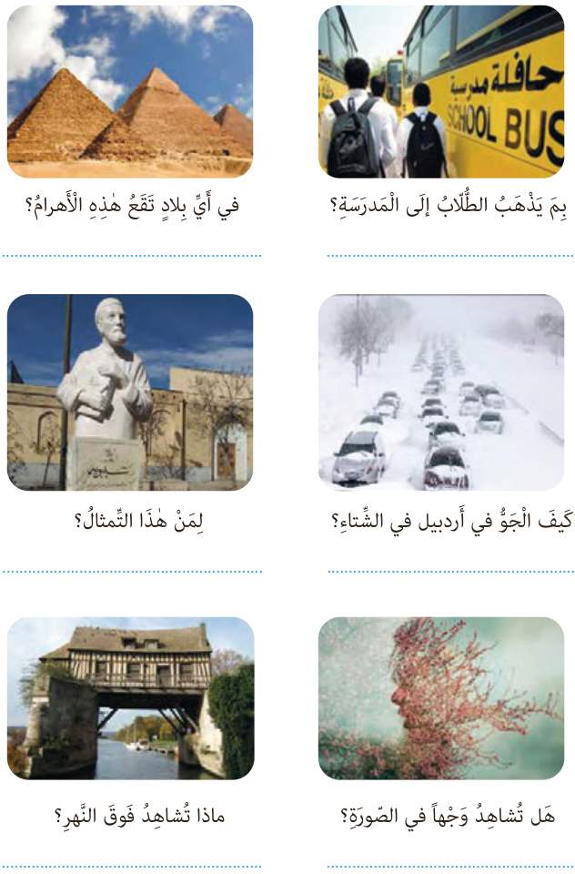

## التَّمْرینُ الثّالِثُ: أَجِبْ عَنِ الْأَسْئِلَةِ التّالِیَةِ حَسَبَ الصُّوَرِ.

بِمَ یَذْهَبُ الطُّلّابُ إِلَی الْمَدْرَسَةِ؟

فی أَیِّ بِلادٍ تَقَعُ هٰذِهِ الْأَهْرامُ؟

کَیْفَ الْجَوُّ فی أَرْدَبیل فی الشِّتاءِ؟

لِمَنْ هٰذَا التِّمْثالُ؟

هَلْ تُشاهِدُ وَجْهاً فِی الصُّورَةِ؟

ماذا تُشاهِدُ فَوْقَ النَّهْرِ؟
