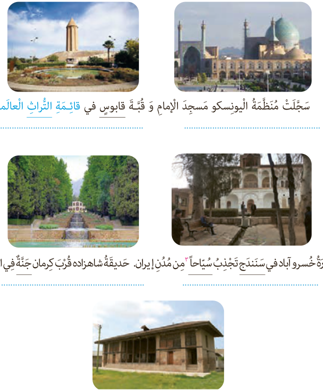

### ب: تَرْجِمِ الْجُمَلَ التّالِیَةَ حَسَبَ قَواعِدِ الْمَعْرِفَةِ وَ النَّکِرَةِ، ثُمَّ عَیِّنِ الْمَعْرِفَةَ وَ النَّکِرَةَ فی ما أُشیرَ¹ إِلَیْهِ بِخَطٍّ.

سَجَّلَتْ مُنَظَّمَةُ الْیُونِسْکُو مَسْجِدَ الْإِمامِ وَ قُبَّةَ قابُوسَ فی قائِمَةِ التُّراثِ الْعالَمِیِّ².

عِمارَةُ خُسْرَوآباد فی سَنَنْدَج تَجْذِبُ سُیّاحاً³ مِنْ مُدُنِ إیران. حَدیقَةُ شاهْزادَه قُرْبَ کِرمان جَنَّةٌ فِی الصَّحْراءِ.

مَعْبَدُ کُرْدکُلا⁴ فی مُحافَظَةِ مازَنْدَران أَحَدُ الْآثارِ الْقَدیمَةِ.

۱ـ أُشیرَ: اشاره شد  ۲ـ قائِمَةُ التُّراثِ الْعالَمِیّ: لیست میراث جهانی  ۳ـ سُیّاح: گردشگران، مفرد آن: سائِح  ۴ـ تکیهٔ کُرد کلا از آثار ملّی ایران در شمال شهرستان جویبار
