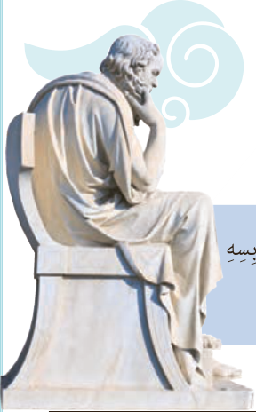

«اِتَّقُوا مَواضِعَ التُّهَمِ.» رَسُولُ اللّٰهِ صَلَّی اللّٰهُ عَلَیْهِ وَ آلِهِ الْمُتَکَلِّمُ یُعْرَفُ بِکَلامِهِ.

«تَکَلَّمُوا تُعْرَفُوا، فَإِنَّ الْمَرْءَ مَخْبُوءٌ تَحْتَ لِسانِهِ.» الْإِمامُ عَلِیٌّ عَلَیْهِ السَّلامُ

فی بَعْضِ الْأَوْقاتِ قُدْرَةُ الْکَلامِ أَقْویٰ مِنَ السِّلاحِ.

«رُبَّ کَلامٍ کَالْحُسامِ.» الْإِمامُ عَلِیٌّ عَلَیْهِ السَّلامُ

وَ رُبَّ کَلامٍ یَجْلِبُ لَکَ الْمَشاکِلَ.

«فَکِّرْ ثُمَّ تَکَلَّمْ تَسْلَمْ مِنَ الزَّلَلِ.» الْإِمامُ عَلِیٌّ عَلَیْهِ السَّلامُ

یَجِبُ عَلَی الْإِنْسانِ الْإِجْتِنابُ عَنْ ذِکْرِ الْأَقْوالِ الَّتی فیها اِحْتِمالُ الْکِذْبِ.

«لا تُحَدِّثْ بِما تَخافُ تَکْذیبَهُ.» الْإِمامُ عَلِیٌّ عَلَیْهِ السَّلامُ

طُوبیٰ لِمَنْ لا یَخافُ النّاسُ مِنْ لِسانِهِ.

«مَنْ خافَ النّاسُ مِنْ لِسانِهِ فَهُوَ مِنْ أَهْلِ النّارِ.» رَسُولُ اللّٰهِ صَلَّی اللّٰهُ عَلَیْهِ وَ آلِهِ

وَ مِنْ آدابِ الْکَلامِ قِلَّتُهُ،

«خَیْرُ الْکَلامِ ما قَلَّ وَ دَلَّ¹.» الْإِمامُ عَلِیٌّ عَلَیْهِ السَّلامُ

وَقَفَ رَجُلٌ جَمیلُ الْمَظْهَرِ أَمامَ سُقْراطَ یَفْتَخِرُ بِمَلابِسِهِ وَ بِمَظْهَرِهِ، فَقالَ لَهُ سُقْراطُ: تَکَلَّمْ حَتّیٰ أَراکَ.

۱ـ ما قَلَّ وَ دَلَّ: آنچه کم باشد و راهنمایی کند. (سخنی کوتاه که منظور را کامل به شنونده برساند.)
