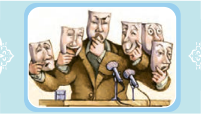

# التَّمارین
## التَّمْرینُ الْأَوَّلُ: اِمْلَأِ الْفَراغَ فی آیاتِ نَصِّ الدَّرْسِ وَ أَحادیثِهِ بِکَلِماتٍ صَحیحَةٍ.

عِلْمٌ، النّارِ، عُقُولِهِمْ، الْحَسَنَةِ، أَحْسَنُ، لِسانِهِ، تَفْعَلُونَ

۱ـ ﴿اُدْعُ إِلیٰ سَبیلِ رَبِّکَ بِالْحِکْمَةِ وَ الْمَوْعِظَةِ ........ وَ جادِلْهُمْ بِالَّتی هِیَ ........﴾ النَّحْل: ۱۲۵

۲ـ ﴿وَ لا تَقْفُ ما لَیْسَ لَکَ بِهِ ........﴾ الْإِسْراء: ۳۶

۳ـ ﴿لِمَ تَقُولُونَ ما لا ........﴾ الصَّفّ: ۲

۴ـ کَلِّمِ النّاسَ عَلیٰ قَدْرِ ........ . رَسُولُ اللّٰهِ صَلَّی اللّٰهُ عَلَیْهِ وَ آلِهِ

۵ـ تَکَلَّمُوا تُعْرَفُوا فَإِنَّ الْمَرْءَ مَخْبُوءٌ تَحْتَ ........ . الْإِمامُ عَلِیٌّ عَلَیْهِ السَّلامُ

۶ـ مَنْ خافَ النّاسُ مِنْ لِسانِهِ فَهُوَ مِنْ أَهْلِ ........ . رَسُولُ اللّٰهِ صَلَّی اللّٰهُ عَلَیْهِ وَ آلِهِ

