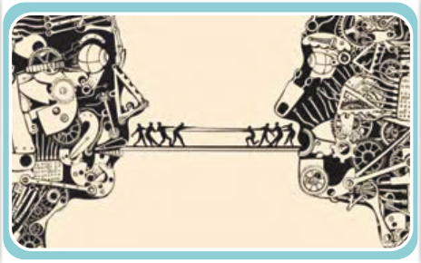

# الْبَحْثُ الْعِلْمِیُّ

■ اِبْحَثْ عَنْ خَمْسِ آیاتٍ أَوْ أَحادیثَ حَوْلَ قَواعِدِ الدَّرْسِ.

﴿... وَ جَعَلْنا لَهُ نُوراً یَمْشی بِهِ فِی النّاسِ ...﴾ الْأَنْعام: ۱۲۲

﴿... إِنّا سَمِعْنا کِتاباً أُنْزِلَ مِنْ بَعْدِ مُوسیٰ ...﴾ الْأَحْقاف: ۳۰

﴿وَ جَعَلْناهُمْ أَئِمَّةً یَهْدُونَ بِأَمْرِنا ...﴾ الْأَنْبِیاء: ۷۳

۱ـ ........

۲ـ ........

۳ـ ........

۴ـ ........

۵ـ ........
