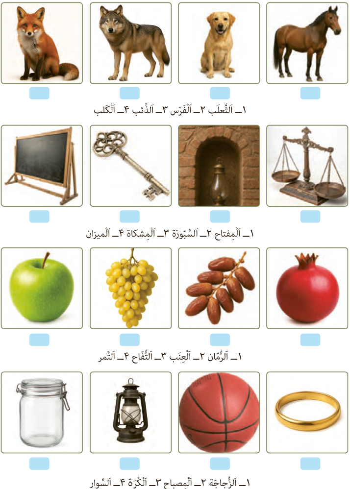

## (لِلتَّمْرینِ فِی الْمَنْزِلِ) اُکْتُبِ اسْمَ کُلِّ صُورَةٍ.

۱ـ الثَّعْلَب  ۲ـ الْفَرَس  ۳ـ الذِّئْب  ۴ـ الْکَلْب

۱ـ الْمِفْتاح  ۲ـ السَّبُّورَة  ۳ـ الْمِشْکاة  ۴ـ الْمیزان

۱ـ الرُّمّان  ۲ـ الْعِنَب  ۳ـ التُّفّاح  ۴ـ التَّمْر

۱ـ الزُّجاجَة  ۲ـ الْمِصْباح  ۳ـ الْکُرَة  ۴ـ السِّوار
