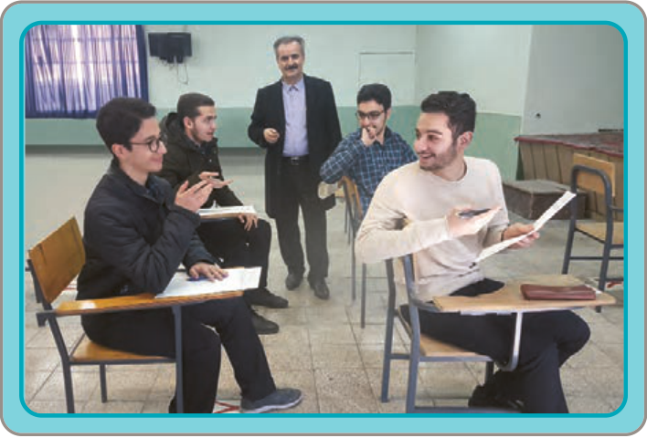

فَاتَّصَلُوا بِالْأُسْتاذِ هاتِفِیّاً وَ قالُوا لَهُ:

أَحَدُ إِطاراتِ سَیّارَتِنا اِنْفَجَرَ، وَ لَیْسَ لَنا إِطارٌ اِحْتِیاطِیٌّ،

وَ لا تُوجَدُ سَیّارَةٌ تَنْقُلُنا إِلَی الْجامِعَةِ،

وَ نَحْنُ الْآنَ فِی الطَّریقِ بَعیدُونَ عَنِ الْجامِعَةِ،

وَ لَنْ نَسْتَطیعَ الْحُضُورَ فِی الْإِمْتِحانِ فِی الْوَقْتِ الْمُحَدَّدِ.

وافَقَ الْأُسْتاذُ أَنْ یُؤَجِّلَ لَهُمُ الْإِمْتِحانَ لِمُدَّةِ أُسْبُوعٍ واحِدٍ،

فَفَرِحَ الطُّلّابُ بِذٰلِکَ؛ لِأَنَّ خُطَّتَهُمْ لِتَأْجیلِ الْإِمْتِحانِ نَجَحَتْ.

فِی الْأُسْبُوعِ التّالی حَضَرُوا لِلْإِمْتِحانِ فِی الْوَقْتِ الْمُحَدَّدِ،

وَ طَلَبَ الْأُسْتاذُ مِنْهُمْ أَنْ یَجْلِسُوا فی قاعَةِ الْإِمْتِحانِ،

ثُمَّ وَزَّعَ عَلَیْهِمْ أَوْراقَ الْإِمْتِحانِ.

