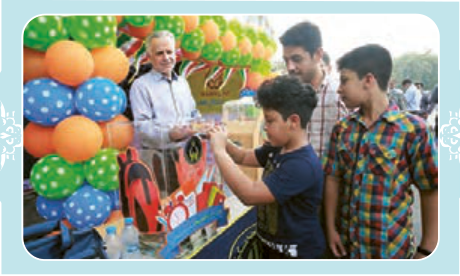

# اِخْتَبِرْ نَفْسَکَ: تَرْجِمِ الْآیَتَیْنِ وَ الْحَدیثَ حَسَبَ قَواعِدِ الدَّرْسِ، ثُمَّ عَیِّنِ الْأَفْعالَ الْمُضارِعَةَ.

۱. ﴿وَ عَسیٰ أَنْ تَکْرَهُوا شَیْئاً وَ هُوَ خَیْرٌ لَکُمْ وَ عَسیٰ أَنْ تُحِبُّوا شَیْئاً وَ هُوَ شَرٌّ لَکُمْ﴾ الْبَقَرَة: ۲۱۶

۲. مِنْ أَخْلاقِ الْجاهِلِ الْإِجابَةُ قَبْلَ أَنْ یَسْمَعَ وَ الْمُعارَضَةُ¹ قَبْلَ أَنْ یَفْهَمَ وَ الْحُکْمُ بِما لا یَعْلَمُ. الْإِمامُ الصّادِقُ عَلَیْهِ السَّلامُ

۳. ﴿... أَنْفِقُوا مِمّا رَزَقْناکُمْ² مِنْ قَبْلِ أَنْ یَأْتِیَ یَوْمٌ لا بَیْعٌ فیهِ وَ لا خُلَّةٌ³ ...﴾ الْبَقَرَة: ۲۵۴

۱ـ مُعارَضَة: مخالفت  ۲ـ رَزَقَ: روزی داد  ۳ـ خُلَّة: دوستی
