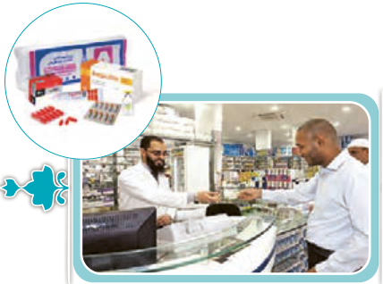

■ در گروه‌های دو نفره شبیه گفت‌وگوی زیر را اجرا کنید.

# حِوارٌ (فِی الصَّیْدَلِیَّةِ¹)

| الْحاجُّ | الصَّیْدَلِیُّ |
|---|---|
| سَلامٌ عَلَیْکُمْ. عَفْواً، ما عِنْدی وَصْفَةٌ وَ أُریدُ هٰذِهِ الْأَدْوِیَةَ² الْمَکْتُوبَةَ عَلَی الْوَرَقَةِ. | وَ عَلَیْکُمُ السَّلامُ. أَعْطِنی الْوَرَقَةَ: مِحْرارٌ³، حُبُوبٌ مُسَکِّنَةٌ لِلصُّداعِ، حُبُوبٌ مُهَدِّئَةٌ، کَبْسُول أَمْبیسیلین، قُطْنٌ⁴ طِبِّیٌّ، مَرْهَمٌ⁵ لِحَسّاسِیَّةِ الْجِلْدِ⁶ ... لا بَأْسَ، وَ لٰکِنْ لا أُعْطیکَ أَمْبیسیلین. |
| لِماذا لا تُعْطینی؟ | لِأَنَّ بَیْعَها بِدُونِ وَصْفَةٍ غَیْرُ مَسْمُوحٍ. رَجاءً، راجِعِ⁷ الطَّبیبَ؛ الشِّفاءُ مِنَ اللّٰهِ. |

۱ـ الصَّیْدَلِیَّة: داروخانه  ۲ـ الْأَدْوِیَة: داروها، مفرد: الدَّواء  ۳ـ الْمِحْرار: دماسنج  ۴ـ الْقُطْن: پنبه  ۵ـ مَرْهَم: پماد  ۶ـ الْجِلْد: پوست  ۷ـ راجِعْ: مراجعه کن
