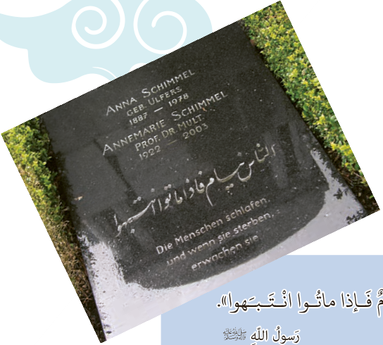

أَلَّفَتْ شیمِل أَکْثَرَ مِنْ مِئَةِ کِتابٍ وَ مَقالَةٍ مِنْها کِتابٌ حَوْلَ شَخْصِیَّةِ جَلالِ الدّینِ الْبَلْخِیِّ.

هِیَ کانَتْ تُحِبُّ الْعَیْشَ فِی الشَّرْقِ، لِذٰلِکَ دَرَّسَتْ مُدَّةً طَویلَةً فِی الْهِنْدِ وَ باکِسْتان، وَ دَرَّسَتْ کَذٰلِکَ ما یُقارِبُ خَمْسَةً وَ عِشْرینَ عاماً فی جامِعَةِ هارْفارد.

قَبْلَ وَفاتِها أَوْصَتْ شیمِل زُمَلاءَها أَنْ یُشَکِّلُوا فَریقاً لِلْحِوارِ الدّینِیِّ وَ الثَّقافِیِّ یَکُونُ هَدَفُهُ الْأَعْلیٰ «مَدَّ جُسُورِ الصَّداقَةِ وَ التَّفاهُمِ بَیْنَ أُورُوبّا وَ الْعالَمِ الْإِسْلامِیِّ» وَ «الْإِتِّحادَ بَیْنَ الْحَضاراتِ».

أَشارَتْ شیمِل فی إِحْدیٰ مُقابَلاتِها إِلَی الْأَدْعِیَةِ الْإِسْلامِیَّةِ وَ قالَتْ:

«أَنا أَقْرَأُ الْأَدْعِیَةَ وَ الْأَحادیثَ الْإِسْلامِیَّةَ بِاللُّغَةِ الْعَرَبِیَّةِ وَ لا أُراجِعُ تَرْجَمَتَها».

هِیَ أَوْصَتْ آنِه ماری أَنْ یُکْتَبَ هٰذَا الْحَدیثُ عَلیٰ قَبْرِها:

«النّاسُ نِیامٌ فَإِذا ماتُوا انْتَبَهُوا». رَسُولُ اللّٰهِ صَلَّی اللّٰهُ عَلَیْهِ وَ آلِهِ
