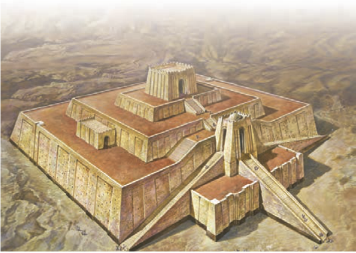

## التَّمْرینُ السّابِعُ: ضَعْ فِی الْفَراغِ کَلِمَةً مُناسِبَةً مِنَ الْکَلِماتِ التّالِیَةِ. «کَلِمَتانِ زائِدَتانِ»

أَنْقَرَة / الْإِنْجِلیزِیَّة / الْحَضارَة / فَخْرِیَّة / مُنْذُ / الْمُسْتَشْرِق / مُحاضَرَةً / شَهادات

۱ـ ما رَأَیْتُ جیرانی ........ یَوْمِ الْخَمیسِ.

۲ـ نَتَعَلَّمُ اللُّغَةَ ........ مِنَ الصَّفِّ السّابِعِ.

۳ـ أَلْقَی الْأُسْتاذُ ........ ثَقافِیَّةً أَمامَ الطُّلّابِ.

۴ـ کانَتِ ........ السُّومَرِیَّةُ فی جَنُوبِ الْعِراقِ.

۵ـ الدُّکْتُوراه مِنْ أَعْلیٰ ........ التَّخَصُّصِ فِی الْجامِعاتِ.

۶ـ إِنَّ ........ عالِمٌ مِنَ الدُّوَلِ الْغَرْبِیَّةِ عارِفٌ بِالثَّقافَةِ الشَّرْقِیَّةِ.

