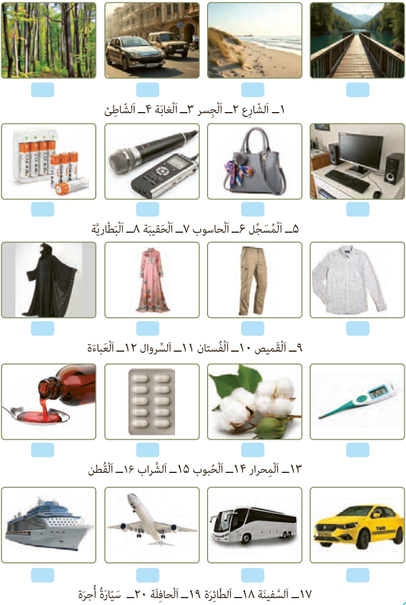

## (لِلتَّمْرینِ فِی الْمَنْزِلِ) اُکْتُبِ اسْمَ کُلِّ صُورَةٍ.

۱ـ الشّارِع  ۲ـ الْجِسْر  ۳ـ الْغابَة  ۴ـ الشّاطِئ

۵ـ الْمُسَجِّل  ۶ـ الْحاسُوب  ۷ـ الْحَقیقَة  ۸ـ الْبَطّارِیَّة

۹ـ الْقَمیص  ۱۰ـ الْفُسْتان  ۱۱ـ السِّرْوال  ۱۲ـ الْعَباءَة

۱۳ـ الْمِحْرار  ۱۴ـ الْحُبُوب  ۱۵ـ الشَّراب  ۱۶ـ الْقُطْن

۱۷ـ السَّفینَة  ۱۸ـ الطّائِرَة  ۱۹ـ الْحافِلَة  ۲۰ـ سَیّارَةُ أُجْرَة
