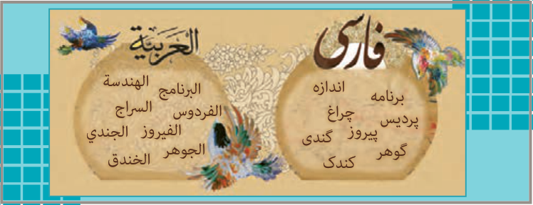

# الدَّرْسُ السّابِعُ
## تَأْثیرُ اللُّغَةِ الْفارِسِیَّةِ عَلَی اللُّغَةِ الْعَرَبِیَّةِ

الْمُفْرَداتُ الْفارِسِیَّةُ دَخَلَتِ اللُّغَةَ الْعَرَبِیَّةَ مُنْذُ الْعَصْرِ الْجاهِلِیِّ، فَقَدْ نُقِلَتْ إِلَی الْعَرَبِیَّةِ أَلْفاظٌ فارِسِیَّةٌ کَثیرَةٌ بِسَبَبِ التِّجارَةِ وَ دُخُولِ الْإیرانِیّینَ فِی الْعِراقِ وَ الْیَمَنِ، وَ کانَتْ تِلْکَ الْمُفْرَداتُ تَرْتَبِطُ بِبَعْضِ الْبَضائِعِ الَّتی ما کانَتْ عِنْدَ الْعَرَبِ کَالْمِسْکِ وَ الدّیباجِ. وَ اشْتَدَّ النَّقْلُ مِنَ الْفارِسِیَّةِ إِلَی الْعَرَبِیَّةِ بَعْدَ انْضِمامِ إیران إِلَی الدَّوْلَةِ الْإِسْلامِیَّةِ.

وَ فِی الْعَصْرِ الْعَبّاسِیِّ اِزْدادَ نُفُوذُ اللُّغَةِ الْفارِسِیَّةِ. وَ کانَ لِابْنِ الْمُقَفَّعِ دَوْرٌ عَظیمٌ فی هٰذَا التَّأْثیرِ، فَقَدْ نَقَلَ عَدَداً مِنَ الْکُتُبِ الْفارِسِیَّةِ إِلَی الْعَرَبِیَّةِ، مِثْلَ کَلیلَةَ وَ دِمْنَةَ.

وَ لِلْفیروزآبادِیِّ مُعْجَمٌ مَشْهُورٌ بِاسْمِ الْقامُوسِ یَضُمُّ مُفْرَداتٍ کَثیرَةً بِاللُّغَةِ الْعَرَبِیَّةِ.

وَ قَدْ بَیَّنَ عُلَماءُ اللُّغَةِ الْعَرَبِیَّةِ وَ الْفارِسِیَّةِ أَبْعادَ هٰذَا التَّأْثیرِ فی دِراساتِهِمْ، فَقَدْ أَلَّفَ الدُّکْتُورُ
