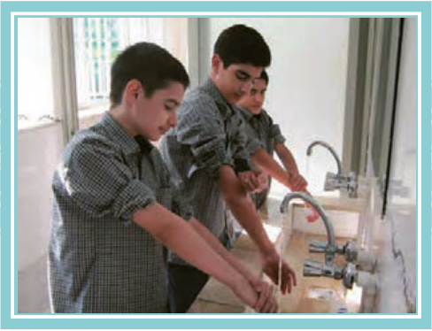

■ در گروه‌های دو نفره شبیه گفت‌وگوی زیر را اجرا کنید.

# حِوارٌ (فِی الْمَسْجِدِ)

| أَحْمَد | حَسَن |
|---|---|
| لِماذا تُسْرِعُ؟ | هٰذا أَذانُ الظُّهْرِ، أَنا ذاهِبٌ إِلَی الْمَسْجِدِ لِأُصَلّیَ¹. |
| اِنْتَظِرْ²، أَنا ذاهِبٌ مَعَکَ. | تَعالَ³ لِنَتَوَضَّأَ⁴، ثُمَّ نَذْهَبَ مَعاً. |
| أَسْرِعْ⁵، الْإِمامُ یَدْخُلُ الْمَسْجِدَ. | تَعالَ نَذْهَبْ، أَنا قادِمٌ. |

۱ـ لِأُصَلّیَ: برای اینکه نماز بخوانم  ۲ـ اِنْتَظِرْ: منتظر باش  ۳ـ تَعالَ: بیا  ۴ـ لِنَتَوَضَّأَ: تا وضو بگیریم  ۵ـ أَسْرِعْ: عجله کن
