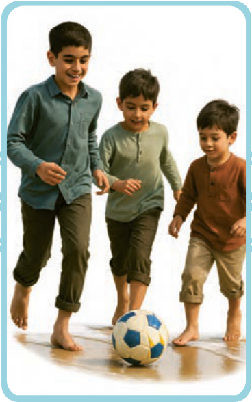

۴ـ کانَ الْأَطْفالُ یَلْعَبُونَ بِالْکُرَةِ عَلَی الشّاطِئِ وَ بَعْدَ اللَّعِبِ صارُوا نَشیطینَ.

الف) □ کودکان در کنار ساحل با توپ بازی می‌کردند و پس از بازی با نشاط شدند.

ب) □ بچّه‌ها در کنار ساحل توپ بازی کردند و بعد از بازی پر نشاط، خوشحال هستند.

الْمَجْرُور بِحَرْفِ الْجَرّ، وَ الْمُضافُ إِلَیْهِ: ........

۵ـ کُنْتُ ساکِتاً وَ ما قُلْتُ کَلِمَةً، لِأَنّی کُنْتُ لا أَعْرِفُ شَیْئاً عَنِ الْمَوْضُوعِ.

الف) □ ساکت شدم و کلمه‌ای نمی‌گویم؛ برای اینکه چیزی از موضوع نمی‌دانم.

ب) □ ساکت بودم و کلمه‌ای نگفتم؛ زیرا چیزی دربارهٔ موضوع نمی‌دانستم.

الْمَفْعُول، وَ الْجارُّ وَ الْمَجْرُور: ........
