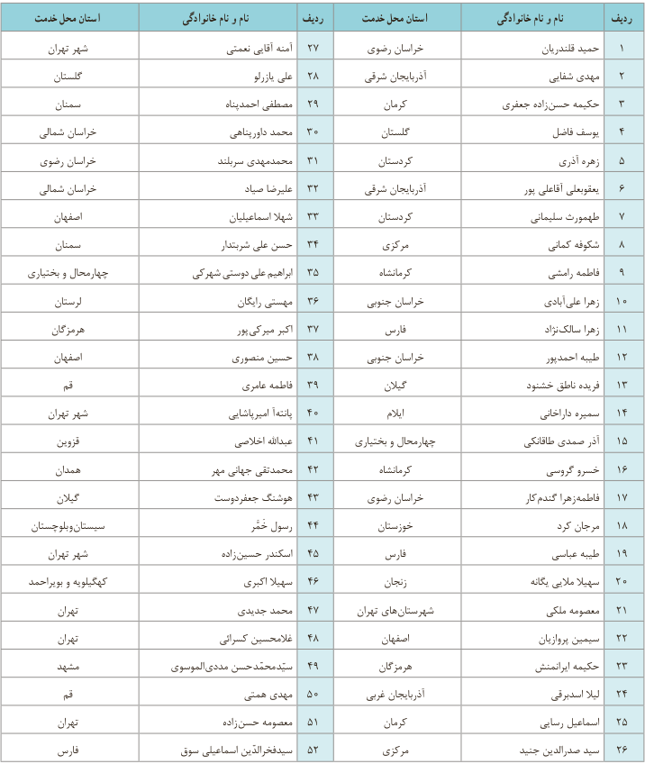

سازمان پژوهش و برنامه‌ریزی آموزشی جهت ایفای نقش خطیر خود در اجرای سند تحول بنیادین در آموزش و پرورش و برنامه درسی ملی جمهوری اسلامی ایران، مشارکت معلمان را به‌عنوان یک سیاست اجرایی مهم دنبال می‌کند. برای تحقق این امر در اقدامی نوآورانه سامانه تعاملی بر خط اعتبارسنجی کتاب‌های درسی راه‌اندازی شد تا با دریافت نظرات معلمان درباره کتاب‌های درسی نونگاشت، کتاب‌های درسی را در اولین سال چاپ، با کمترین اشکال به دانش‌آموزان و معلمان ارجمند تقدیم نماید. در انجام مطلوب این فرایند، همکاران گروه تحلیل محتوای آموزشی و پرورشی استان‌ها، گروه‌های آموزشی، دبیرخانه راهبری دروس و مدیریت محترم پروژه آقای محسن یاهو نقش سازنده‌ای را بر عهده داشتند. ضمن ارج نهادن به تلاش تمامی این همکاران، اسامی دبیران و هنرآموزانی که تلاش مضاعفی، در این زمینه داشته و با ارائه نظرات خود سازمان را در بهبود محتوای این کتاب یاری کرده‌اند به شرح زیر اعلام می‌شود.

# اسامی دبیران شرکت‌کننده در اعتبارسنجی کتاب عربی، زبان قرآن (۲) ـ کد ۱۱۱۲۰۶

| ردیف | نام و نام خانوادگی | استان محل خدمت | ردیف | نام و نام خانوادگی | استان محل خدمت |
|---|---|---|---|---|---|
| ۱ | حمید قلندریان | خراسان رضوی | ۲۷ | آمنه آقایی نعمتی | شهر تهران |
| ۲ | مهدی شفایی | آذربایجان شرقی | ۲۸ | علی بازرلو | گلستان |
| ۳ | حکیمه حسن‌زاده جعفری | کرمان | ۲۹ | مصطفی احمدپناه | سمنان |
| ۴ | یوسف فاضل | گلستان | ۳۰ | محمد داوری‌پناهی | خراسان شمالی |
| ۵ | زهره آذری | کردستان | ۳۱ | محمدمهدی سربلند | خراسان رضوی |
| ۶ | یعقوبعلی آقاعلی پور | آذربایجان شرقی | ۳۲ | علیرضا صیاد | خراسان شمالی |
| ۷ | طهمورث سلیمانی | کردستان | ۳۳ | شهلا اسماعیلیان | اصفهان |
| ۸ | شکوفه کیانی | مرکزی | ۳۴ | حسن علی شریعتدار | سمنان |
| ۹ | فاطمه رامشی | کرمانشاه | ۳۵ | ابراهیم علی دوستی شهرکی | چهارمحال و بختیاری |
| ۱۰ | زهرا علی‌آبادی | خراسان جنوبی | ۳۶ | مهستی رایگان | لرستان |
| ۱۱ | زهرا سالک‌نژاد | فارس | ۳۷ | اکبر میریکی‌پور | هرمزگان |
| ۱۲ | طیبه احمدپور | خراسان جنوبی | ۳۸ | حسین منصوری | اصفهان |
| ۱۳ | فریده ناطق خشنود | گیلان | ۳۹ | فاطمه عامری | قم |
| ۱۴ | سمیره داراخانی | ایلام | ۴۰ | پانته‌آ امیریانادلی | شهر تهران |
| ۱۵ | آذر صمدی طالقانی | چهارمحال و بختیاری | ۴۱ | عبدالله اخلاصی | قزوین |
| ۱۶ | خسرو گروسی | کرمانشاه | ۴۲ | محمدتقی جهانی مهر | همدان |
| ۱۷ | فاطمه‌زهرا گندم‌کار | خراسان رضوی | ۴۳ | هوشنگ جعفردوست | گیلان |
| ۱۸ | مرجان کرد | خوزستان | ۴۴ | رسول خمر | سیستان‌وبلوچستان |
| ۱۹ | طیبه عباسی | فارس | ۴۵ | اسکندر حسین‌زاده | شهر تهران |
| ۲۰ | سهیلا ملایی یگانه | زنجان | ۴۶ | سهیلا اکبری | کهگیلویه و بویراحمد |
| ۲۱ | معصومه ملکی | شهرستان‌های تهران | ۴۷ | محمد جدیدی | تهران |
| ۲۲ | سیمین پورآریان | اصفهان | ۴۸ | غلامحسین کسرایی | تهران |
| ۲۳ | حکیمه ابراهیم‌نژاد | هرمزگان | ۴۹ | سیدمحمدحسن مددی الموسوی | مشهد |
| ۲۴ | لیلا اسدبیگی | آذربایجان غربی | ۵۰ | مهدی همتی | قم |
| ۲۵ | اسماعیل رسایی | کرمان | ۵۱ | معصومه حسن‌زاده | تهران |
| ۲۶ | سید صدرالدین جنیدی | مرکزی | ۵۲ | سیدفخرالدین اسماعیلی سوق | فارس |
