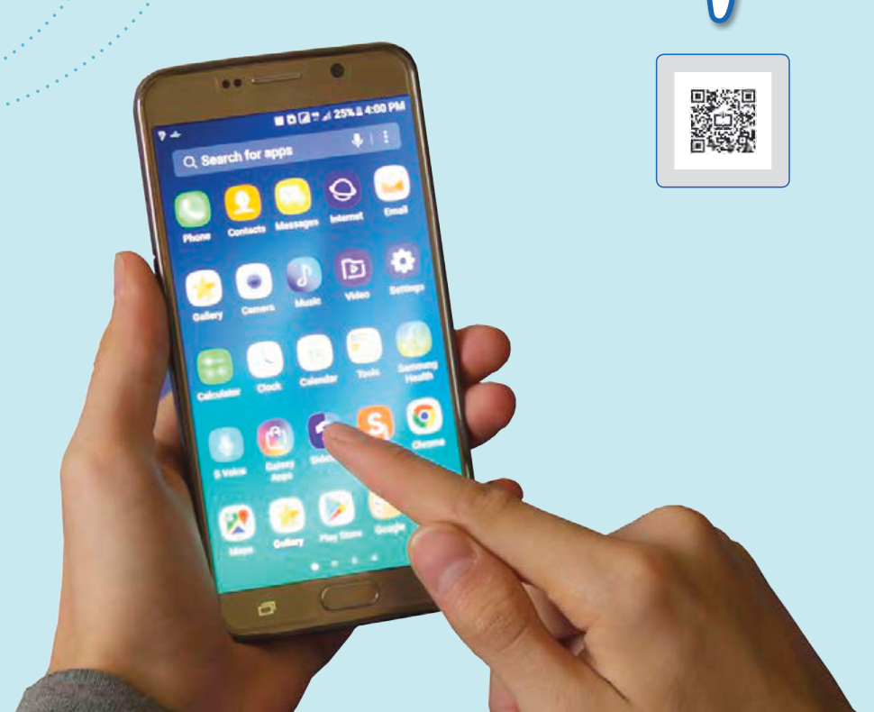

# فصل ۱: الکتریسیتۀ ساکن

صفحه‌های لمسی، امروزه کاربردی گسترده در زندگی روزمره پیدا کرده‌اند، از صفحه‌های رایانه گرفته تا گوشی‌های تلفن همراه و ابزارهای پزشکی و صنعتی. این صفحه‌ها به روش‌های مختلفی عمل می‌کنند که یکی از متداول‌ترین آنها مبتنی بر استفاده از خازن‌ها است. با تماس انگشت با یک صفحۀ لمسی، ظرفیت الکتریکی در آن محل عوض می‌شود که مدارهای الکترونیکی دستگاه می‌توانند آن تغییر را آشکار کنند.
