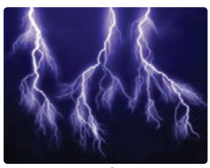
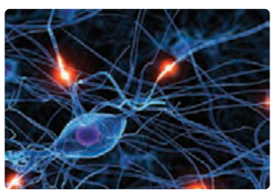
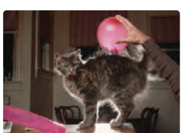
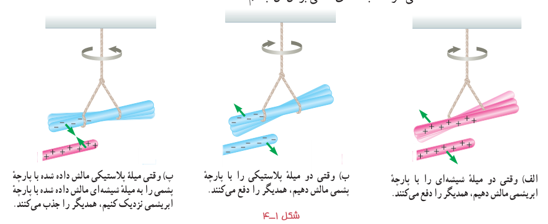

از آذرخش گرفته (شکل ۱ـ۱) تا درخشش لامپی کوچک، از آنچه اتم‌ها را به شکل مولکول به هم پیوند می‌دهد، تا پیام‌های عصبی در دستگاه اعصاب (شکل ۱ـ۲)، و همچنین بسیاری از پدیده‌های دیگر مانند قابلیت چسبیدن نوار سلوفان بر ظروف و حتی بالا رفتن یک مارمولک از دیوار و بسیاری از وسیله‌های اطراف ما، همگی منشأ الکتریکی دارند. مبانی فیزیکی مرتبط با این پدیده‌ها نخستین بار مورد توجه فیلسوفان یونان قدیم قرار گرفت که دریافتند اگر قطعه‌ای از کهربا¹ با پارچۀ پشمی مالش داده شود و سپس به خرده‌های کاه نزدیک گردد، آن خرده‌ها به سوی کهربا کشیده می‌شوند. امروز می‌دانیم این کشش ناشی از یک نیروی الکتریکی است. در واقع واژۀ الکتریسیته از واژۀ یونانی الکترون² گرفته شده است که به معنای کهرباست.

شکل ۱ـ۱ توصیف آذرخش مبتنی بر اصول الکتریسیتۀ ساکن است.

شکل ۱ـ۲ انتقال پیام‌های عصبی در دستگاه اعصاب به‌صورت الکتریکی صورت می‌گیرد.

وقتی لباس‌های بافتنی را از تن خارج می‌کنیم، یا پس از اینکه چند قدم بر روی فرشی راه می‌رویم، دستگیرۀ فلزی در را با دست بگیریم، عملاً وجود الکتریسیته را به صورت یک شوک الکتریکی حس می‌کنیم.

در این فصل، به مطالعۀ بارهای ساکن می‌پردازیم که به آن **الکتریسیتۀ ساکن** (الکتروستاتیک) می‌گویند و ضمن یادآوری مطالب الکتریسیتۀ دورۀ اول متوسطه، به جزئیات دقیق‌تری از چگونگی ایجاد بار الکتریکی در یک جسم، عوامل مؤثر بر نیروی الکتریکی بین دو بار الکتریکی ذره‌ای، میدان الکتریکی، انرژی پتانسیل الکتریکی و اختلاف پتانسیل الکتریکی، توزیع بار در یک جسم رسانا و کاربرد خازن‌ها می‌پردازیم.

## ۱ـ۱ بار الکتریکی

در کتاب علوم تجربی پایۀ هشتم دیدید که معمولاً وقتی دو جسم با یکدیگر مالش داده می‌شوند، هر دوی آنها دارای بار الکتریکی می‌شوند (شکل ۱ـ۳) و بر یکدیگر نیرو وارد می‌کنند (شکل ۱ـ۴). از این تجربه‌ها نتیجه گرفتیم که دو نوع بار الکتریکی وجود دارد. این دو نوع بار الکتریکی توسط دانشمند امریکایی بنجامین فرانکلین، بار مثبت و بار منفی نام‌گذاری شد. او می‌توانست آنها را هر چیز دیگری نیز بنامد، اما استفاده از علامت‌های جبری به جای نام‌های دیگر این مزیت را دارد که وقتی در یک جسم از این دو نوع بار به مقدار مساوی وجود داشته باشد، جمع جبری بارهای جسم صفر می‌شود که به معنای خنثی بودن آن جسم است.

شکل ۱ـ۳ مالش بادکنک به بدن گربه سبب ایجاد بار الکتریکی در آنها و در نتیجه برافراشته شدن موهای گربه می‌شود.

شکل ۱ـ۴: الف) وقتی دو میلۀ شیشه‌ای را با پارچۀ ابریشمی مالش دهیم، همدیگر را دفع می‌کنند. ب) وقتی دو میلۀ پلاستیکی را با پارچۀ پشمی مالش دهیم، همدیگر را دفع می‌کنند. پ) وقتی میلۀ پلاستیکی مالش داده شده با پارچۀ پشمی را به میلۀ شیشه‌ای مالش داده شده با پارچۀ ابریشمی نزدیک کنیم، همدیگر را جذب می‌کنند.

۱ـ به صمغ فسیل شدۀ درخت گفته می‌شود که به دلیل رنگ و زیبایی طبیعی، از دیرباز مورد توجه بوده است.  
۲ـ واژۀ یونانی الکترون به‌صورت elektron نوشته می‌شود.
