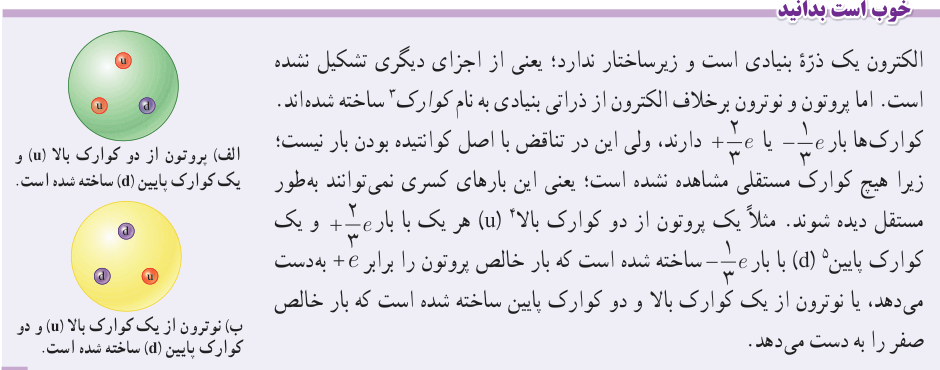

در هنگام مالش، با انتقال تعدادی الکترون از یک جسم به جسمی دیگر، تعادل بارها در اتم خنثی بر هم می‌خورد و جسمی که الکترون از دست می‌دهد، تعداد الکترون‌هایش کمتر از تعداد پروتون‌های آن می‌شود و بار الکتریکی خالص آن مثبت می‌گردد و همچنین، جسمی که الکترون اضافی دریافت می‌کند، الکترون‌هایش از پروتون‌های آن فزونی می‌یابد و بار الکتریکی خالص آن منفی می‌شود. به‌دست آوردن یا از دست دادن الکترون دو جسم در تماس با یکدیگر را می‌توان براساس جدولی موسوم به **سری الکتریسیتۀ مالشی** (تریبوالکتریک؛ Tribo در زبان یونانی به معنای مالش است) معلوم کرد (جدول ۱ـ۱). در این جدول مواد پایین‌تر، الکترون‌خواهی بیشتری دارند؛ یعنی اگر دو ماده در این جدول در تماس با یکدیگر قرار گیرند، الکترون‌ها از مادۀ بالاتر جدول به ماده‌ای که پایین‌تر قرار دارد منتقل می‌شود. مثلاً اگر تفلون با نایلون مالش یابد، الکترون‌ها از نایلون به تفلون منتقل می‌شوند.

در مورد بارهای الکتریکی دو اصل وجود دارد. نخستین آنها **اصل پایستگی بار** است که بیان می‌دارد: مجموع جبری همۀ بارهای الکتریکی در یک دستگاه منزوی² ثابت است؛ یعنی بار می‌تواند از جسمی به جسم دیگر منتقل شود، ولی هرگز امکان تولید یا نابودی یک بار خالص وجود ندارد. تاکنون هیچ آزمایشی این اصل را نقض نکرده است.

دومین اصل، **کوانتیده بودن بار** است. در تجربه‌هایی مانند مالش اجسام به یکدیگر اگر جسم خنثی الکترون به دست آورد یا از دست بدهد، همواره بار الکتریکی مشاهده‌شدۀ جسم، مضرب درستی از بار بنیادی $e$ است:

$$q=\pm ne,\quad n=0,1,2,\ldots\tag{1-1}$$

یک مثال آشنا از کوانتیده بودن یک کمیت، تعداد دانش‌آموزان یک کلاس یا تعداد تخم‌مرغ‌های درون یک ظرف است. برای مثال، ما نمی‌توانیم ۲۴/۳ دانش‌آموز در یک کلاس و یا ۱۲/۴ تخم‌مرغ در یک ظرف داشته باشیم.

### جدول ۱ـ۱ سری الکتریسیتۀ مالشی (تریبوالکتریک)¹

انتهای مثبت سری: موی انسان، شیشه، نایلون، پشم، موی گربه، سرب، ابریشم، آلومینیم، پوست انسان، کاغذ، چوب، پارچۀ کتان، کهربا، برنج، نقره، پلاستیک، پلی‌اتیلن، لاستیک، تفلون: انتهای منفی سری.

### خوب است بدانید

الکترون یک ذرۀ بنیادی است و زیرساختار ندارد؛ یعنی از اجزای دیگری تشکیل نشده است. اما پروتون و نوترون برخلاف الکترون از ذرات بنیادی به نام کوارک³ ساخته شده‌اند. کوارک‌ها بار $-\frac13e$ یا $+\frac23e$ دارند، ولی این در تناقض با اصل کوانتیده بودن بار نیست؛ زیرا هیچ کوارک مستقلی مشاهده نشده است؛ یعنی این بارهای کسری نمی‌توانند به‌طور مستقل دیده شوند. مثلاً یک پروتون از دو کوارک بالا⁴ (u) هر یک با بار $+\frac23e$ و یک کوارک پایین⁵ (d) با بار $-\frac13e$ ساخته شده است که بار خالص پروتون را برابر $+e$ به‌دست می‌دهد، یا نوترون از یک کوارک بالا و دو کوارک پایین ساخته شده است که بار خالص صفر را به دست می‌دهد.

الف) پروتون از دو کوارک بالا (u) و یک کوارک پایین (d) ساخته شده است. ب) نوترون از یک کوارک بالا (u) و دو کوارک پایین (d) ساخته شده است.

۱ـ نیازی به حفظ این جدول نیست.  
۲ـ منظور از دستگاه منزوی در اینجا دستگاهی است که نه از محیط اطراف خود بار بگیرد و نه به آن بار بدهد.  
۳ـ Quark  ۴ـ up  ۵ـ down
