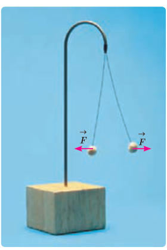
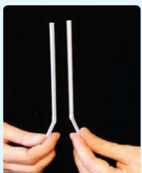

### مثال ۱ـ۱

وقتی روی فرش راه می‌روید و بدنتان بار الکتریکی پیدا می‌کند، هنگام دست دادن با دوستان، ممکن است با انتقال باری در حدود $1\,\mathrm{nC}$ به او شوک خفیفی وارد کنید. در این انتقال بار، حدود چند الکترون بین شما و دوستان منتقل شده است؟

**پاسخ:** از رابطۀ ۱ـ۱ داریم:

$$q=ne$$
$$n=\frac qe=\frac{1\times10^{-9}\,\mathrm C}{1/60\times10^{-19}\,\mathrm C}=6\times10^9\ \text{الکترون}$$

### تمرین ۱ـ۱

عدد اتمی اورانیم $Z=92$ است. بار الکتریکی هستۀ اتم اورانیم چقدر است؟ مجموع بار الکتریکی الکترون‌های اتم اورانیم (خنثی) چه مقدار است؟ بار الکتریکی اتم اورانیم (خنثی) چقدر است؟

## ۱ـ۳ قانون کولن

همان‌طور که می‌دانیم نیروی الکتریکی که دو جسم باردار برهم وارد می‌کنند می‌تواند جاذبه یا دافعه باشد. اگر بارهای الکتریکی دو جسم همنام باشند، این نیرو دافعه است (شکل ۱ـ۶)، و اگر ناهمنام باشند، این نیرو جاذبه است.

شکل ۱ـ۶ گوی‌های باردار همنام یکدیگر را با نیروی هم‌اندازه دفع کرده‌اند.

### فعالیت ۱ـ۱ (کار در کلاس)

مطابق شکل، دو نی پلاستیکی را از نزدیکی یک انتهای آنها خم کنید و پس از مالش دادن با پارچه‌ای پشمی نزدیک یکدیگر قرار دهید. اگر نی‌ها به خوبی باردار شده باشند، نیروی دافعۀ آنها را می‌توانید به وضوح بر روی انگشتان خود حس کنید.

