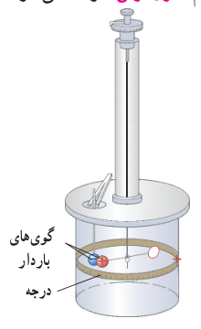
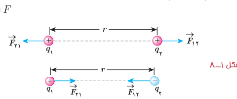

نیروی الکتریکی بین دو جسم باردار، به چه عامل‌هایی بستگی دارد و اندازۀ این نیروها را از چه رابطه‌ای می‌توان محاسبه کرد؟ شارل آگوستین کولن، دانشمند فرانسوی برای نخستین بار با انجام آزمایش‌های ساده و هوشمندانه‌ای توانست عامل‌های مؤثر بر نیروی الکتریکی بین دو ذرۀ باردار را که اصطلاحاً بار نقطه‌ای خوانده می‌شود، شناسایی کند. نتیجۀ آزمایش‌های او امروزه به نام **قانون کولن** خوانده می‌شود. شکل ۱ـ۷ طرحی از آزمایش کولن را نشان می‌دهد.

شکل ۱ـ۷ ترازوی پیچشی کولن. در یک سر یک میلۀ نارسانای سبک افقی یک گوی باردار مثبت کوچک و در سر دیگر آن، یک قرص قرار دارد و میله و قرص توسط یک رشتۀ سیم کشسان و نازک آویخته شده است. یک گوی با بار منفی از حفره‌ای به داخل استوانۀ شیشه‌ای برده می‌شود. درجه‌هایی بر سطح استوانه حک شده است که زاویۀ چرخش میله را نشان می‌دهد. نیروی مؤثر بین این بارها از اندازه‌گیری زاویۀ چرخش تا رسیدن به حالت تعادل به‌دست می‌آید.

قانون کولن بیان می‌دارد:

**اندازۀ نیروی الکتریکی (الکتروستاتیکی) بین دو بار نقطه‌ای¹ که در راستای خط واصل آنها اثر می‌کند، با حاصل‌ضرب بزرگی آنها متناسب است و با مربع فاصلۀ بین آنها نسبت وارون دارد.** بنابراین، اندازۀ این نیرو برابر است با

$$F=k\frac{|q_1||q_2|}{r^2}\tag{1-2}$$

که در آن $q_1$ و $q_2$ بارهای الکتریکی دو بار نقطه‌ای برحسب کولن (C)، $r$ فاصلۀ بین دو بار برحسب متر (m)، و $F$ بزرگی نیروی الکتریکی وارد بر هر بار برحسب نیوتون (N) است. در این رابطه $k$ ثابت الکتروستاتیکی یا ثابت کولن نام دارد و برابر است با²

$$k=8/98755179\times10^9\,\mathrm{N.m^2/C^2}\approx9/0\times10^9\,\mathrm{N.m^2/C^2}$$

در شکل ۱ـ۸، $\vec F_{12}$ نیرویی است که بار نقطه‌ای $q_1$ به بار نقطه‌ای $q_2$ وارد می‌کند و $\vec F_{21}$ نیرویی است که بار نقطه‌ای $q_2$ به بار نقطه‌ای $q_1$ وارد می‌کند. این دو نیروی الکتریکی (بنا به قانون سوم نیوتون) هم‌اندازه، هم‌راستا، و در خلاف جهت همدیگرند. به عبارتی:

$$\vec F_{12}=-\vec F_{21}\Rightarrow F_{12}=F_{21}=F$$

شکل ۱ـ۸ الف) نیروی الکتریکی بین دو بار الکتریکی همنام، دافعه است. ب) نیروی الکتریکی بین دو بار الکتریکی ناهمنام، جاذبه است.

### شارل آگوستین کولن (۱۷۳۶–۱۸۰۶م)

شارل آگوستین کولن در فرانسه به دنیا آمد. او در دانشگاه مباحث متنوعی از قبیل فلسفه، ریاضیات، نجوم و شیمی را آموخت، و در طی دوازده سال پس از فارغ‌التحصیلی شغل‌های متنوعی در شاخه‌های مختلف مهندسی داشت و مدتی را نیز خارج از فرانسه گذراند. کولن پس از بازگشت به پاریس در سال ۱۷۸۵ میلادی تقریباً هم‌زمان با بنجامین فرانکلین آزمایش معروف خود را در مورد اینکه نیروی بین دو بار ذره‌ای با مربع فاصلۀ بین آنها نسبت وارون دارد، به چاپ رساند. نتیجۀ این آزمایش که به قانون کولن معروف شده است از هر آزمون و تجربه‌ای سربلند بیرون آمده است و تاکنون هیچ استثنایی برای آن یافت نشده است. کولن معتقد بود چنین قانونی برای قطب‌های مغناطیسی نیز برقرار است، گرچه هیچ‌وقت نتوانست به چنین رابطه‌ای برسد. نام کولن یکی از ۷۲ نامی است که روی برج ایفل ثبت شده است.

ثابت کولن ($k$) را می‌توان برحسب یک ضریب ثابت دیگر به نام ضریب گذردهی الکتریکی خلأ ($\varepsilon_0$) نیز نوشت:

$$k=\frac1{4\pi\varepsilon_0}$$

که در آن $\varepsilon_0=8/85\times10^{-12}\,\mathrm{C^2/N.m^2}$.

۱ـ در این بخش با نیروهای بین ذره‌های باردار (بارهای نقطه‌ای) سر و کار داریم. البته اگر فاصلۀ یک جسم باردار تا جسم باردار دیگر چنان زیاد باشد که بتوان از ابعاد هر یک از دو جسم در مقایسه با فاصلۀ بین آنها چشم‌پوشی کرد، می‌توان دو جسم را به صورت ذره‌های باردار در نظر گرفت.  
۲ـ به ذهن سپردن این اعداد لازم نیست.
