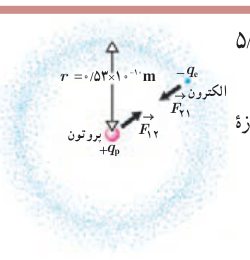
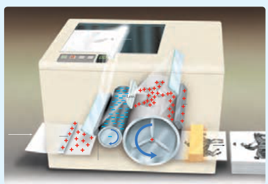

### مثال ۱ـ۲

الف) در مدل بور برای اتم هیدروژن، فاصلۀ الکترون از پروتون هسته در حالت پایه $5/3\times10^{-11}\,\mathrm m$ است (شکل را ببینید). اندازۀ نیروی الکتریکی که پروتون به الکترون وارد می‌کند را محاسبه کنید.

ب) در هستۀ اتم هلیم دو پروتون به فاصلۀ تقریبی $r=2/4\times10^{-15}\,\mathrm m$ از هم قرار دارند. اندازۀ نیرویی که پروتون‌ها بر هم وارد می‌کنند را محاسبه کنید.

**پاسخ:**

الف) با استفاده از قانون کولن برای بزرگی نیروی الکتریکی بین دو ذرۀ باردار داریم:

$$F=k\frac{|q_1||q_2|}{r^2}=k\frac{|q_e||q_p|}{r^2}=(9/0\times10^9\,\mathrm{N.m^2/C^2})\frac{(1/60\times10^{-19}\,\mathrm C)^2}{(5/3\times10^{-11}\,\mathrm m)^2}=8/2\times10^{-8}\,\mathrm N$$

ب) با استفاده از قانون کولن داریم:

$$F=k\frac{|q_p||q_p|}{r^2}=(9/0\times10^9\,\mathrm{N.m^2/C^2})\frac{(1/60\times10^{-19}\,\mathrm C)^2}{(2/4\times10^{-15}\,\mathrm m)^2}=40\,\mathrm N$$

که این به مراتب بزرگ‌تر از نیروی محاسبه‌شده در قسمت الف است. این نیروی بزرگ، از جنس دافعه است. بنابراین، هسته اتم باید فرو بپاشد. از اینجا نتیجه می‌گیریم که باید نیروی دیگری وجود داشته باشد که مانع فروپاشی هسته شود. به این نیرو، نیروی هسته‌ای گفته می‌شود.

### خوب است بدانید

تمامی اجسام به علت جرمشان بر یکدیگر نیروی گرانشی نیز وارد می‌کنند که همواره از نوع جاذبه است. بزرگی این نیرو برای الکترون و پروتون اتم هیدروژن از مرتبۀ $10^{-47}\,\mathrm N$ است. بنابراین، در حدود $10^{40}$ بار کوچک‌تر از نیروی الکتریکی بین این دو ذره است و این نشان می‌دهد نیروی گرانشی به مراتب ضعیف‌تر از نیروی الکتریکی است.

### فعالیت ۱ـ۲

شکل روبه‌رو تصویری از مرحله‌های ایجاد یک رونوشت در دستگاه فتوکپی را نشان می‌دهد. در مورد چگونگی کار دستگاه‌های فتوکپی تحقیق کنید.

