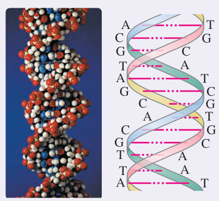
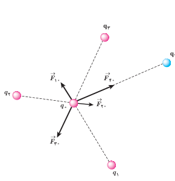
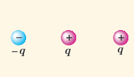

### خوب است بدانید: DNA

اطلاعات ژنتیکی در مولکول‌های خاصی به نام دنا (DNA) وجود دارد. در واقع دنا دارای اطلاعات و دستورهایی برای تعیین و ایجاد صفات ارثی ما و همۀ جانداران است. در مولکول‌های دنا چهار نوع باز به نام‌های آدنین (A)، سیتوزین (C)، گوانین (G) و تیمین (T) وجود دارد. دنا مولکولی دورشته‌ای است که به صورت مارپیچ دوگانه پیچیده شده است. همان‌طور که در شکل نشان داده شده است این دو رشته توسط نیروهای الکتریکی به یکدیگر پیوند خورده‌اند. مثلاً در شکل می‌بینیم که همواره آدنین و تیمین در دو طرف رشته و مقابل هم قرار دارند. به همین ترتیب G و C نیز در دو طرف رشته و مقابل هم قرار دارند.

بارهای مثبت در یک طرف رشته و بارهای منفی در طرف دیگر، دو رشته را به هم زیپ می‌کنند. این جاذبه آن‌قدر هست که رشته‌ها از هم نگسلند، اما به حد کافی ضعیف نیز هست تا در فرایند رونویسی از هم گسیخته گردند.

**برهم‌نهی نیروهای الکتروستاتیکی:** اگر به جای دو ذرۀ باردار، تعدادی بار نقطه‌ای داشته باشیم، نیروی الکتریکی وارد بر هر ذرۀ باردار چگونه تعیین می‌شود؟ تجربه نشان می‌دهد که در این وضعیت، نیروی الکتریکی وارد بر هر ذره، برآیند نیروهایی است که هر یک از ذره‌های دیگر در غیاب سایر ذره‌ها، بر آن ذره وارد می‌کند. این موضوع که از آزمایش نتیجه شده است را **اصل برهم‌نهی** نیروهای الکتروستاتیکی می‌گویند.

فرض کنید $n$ ذرۀ باردار داشته باشیم که در نزدیکی بار نقطه‌ای $q_0$ قرار دارند. آن‌گاه نیروی خالص (برآیند) وارد بر بار نقطه‌ای $q_0$ با جمع برداری زیر داده می‌شود:

$$\vec F_{T0}=\vec F_{10}+\vec F_{20}+\cdots+\vec F_{n0}$$

شکل ۱ـ۹ نیروی وارد بر بار $q_0$ از سوی چهار بار دیگر را نشان می‌دهد. در این کتاب، مثال‌هایی را بررسی می‌کنیم که در آنها نیروهای الکتریکی وارد بر یک ذرۀ باردار در یک راستا قرار دارند یا عمود بر یکدیگرند.¹

شکل ۱ـ۹ نیروی برآیند وارد بر بار $q_0$ در اینجا برابر است با $\vec F_{T0}=\vec F_{10}+\vec F_{20}+\vec F_{30}+\vec F_{40}$.

### پرسش ۱ـ۲

سه ذرۀ باردار مانند شکل روبه‌رو، روی یک خط راست قرار دارند و فاصلۀ بارهای سمت راست و چپ از بار میانی برابر است. الف) جهت نیروی الکتریکی خالص وارد بر بار الکتریکی میانی را تعیین کنید. ب) اگر ذرۀ سمت راست به جای $q$، بار $-q$ داشته باشد، جهت نیروی الکتریکی خالص وارد بر بار میانی چگونه خواهد بود؟

۱ـ بررسی حالت‌هایی که نیروها هم‌راستا و یا عمود برهم نیستند، خارج از برنامۀ درسی این کتاب بوده و نباید مورد ارزشیابی قرار گیرد.
