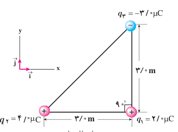
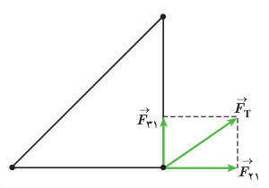

### مثال ۱ـ۴

سه ذرۀ باردار مطابق شکل روبه‌رو در سه رأس مثلث قائم‌الزاویه‌ای ثابت شده‌اند. نیروی الکتریکی خالص وارد بر ذرۀ واقع در رأس قائمه را به‌دست آورده و اندازۀ این نیرو را محاسبه کنید.

**پاسخ:** نیروی الکتریکی بین بارهای $q_1$ و $q_2$ دافعه و نیروی بین بارهای $q_1$ و $q_3$ جاذبه است. با استفاده از رابطۀ ۱ـ۲ داریم:

$$F_{21}=k\frac{|q_2||q_1|}{r_{21}^2}=(9/0\times10^9\,\mathrm{N.m^2/C^2})\frac{(4/0\times10^{-6}\,\mathrm C)(2/0\times10^{-6}\,\mathrm C)}{(3/0\,\mathrm m)^2}=8/0\times10^{-3}\,\mathrm N$$

با توجه به دستگاه مختصات داده شده، $\vec F_{21}$ در جهت مثبت محور $x$ است. بنابراین، $\vec F_{21}=(8/0\times10^{-3}\,\mathrm N)\vec i$ می‌شود. به همین ترتیب، برای نیروی بین بارهای $q_3$ و $q_1$ داریم:

$$F_{31}=k\frac{|q_3||q_1|}{r_{31}^2}=(9/0\times10^9\,\mathrm{N.m^2/C^2})\frac{(3/0\times10^{-6}\,\mathrm C)(2/0\times10^{-6}\,\mathrm C)}{(3/0\,\mathrm m)^2}=6/0\times10^{-3}\,\mathrm N$$

با توجه به دستگاه مختصات داده شده، $\vec F_{31}$ در جهت مثبت محور $y$ است. بنابراین، $\vec F_{31}=(6/0\times10^{-3}\,\mathrm N)\vec j$ می‌شود. پس برآیند نیروهای الکتریکی وارد بر بار $q_1$ برابر است با

$$\vec F_T=\vec F_{21}+\vec F_{31}=(8/0\times10^{-3}\,\mathrm N)\vec i+(6/0\times10^{-3}\,\mathrm N)\vec j$$

و بزرگی آن با استفاده از رابطۀ فیثاغورس، چنین به‌دست می‌آید:

$$F_T=\sqrt{F_{21}^2+F_{31}^2}=\sqrt{(8/0\times10^{-3}\,\mathrm N)^2+(6/0\times10^{-3}\,\mathrm N)^2}=1/0\times10^{-2}\,\mathrm N$$

### تمرین ۱ـ۳

در مثال ۱ـ۴: الف) اگر علامت بار $q_3$ تغییر کند جهت نیروی برآیند وارد بر بار $q_1$ چگونه خواهد شد؟ ب) اگر علامت بار $q_2$ تغییر کند، جهت نیروی برآیند وارد بر بار $q_1$ چگونه خواهد شد؟ پ) آیا اندازۀ نیروی برآیند وارد بر بار $q_1$ در قسمت‌های الف و ب با مقدار به‌دست آمده در مثال ۱ـ۴ متفاوت است؟

## ۱ـ۴ میدان الکتریکی

در بخش ۱ـ۱ دیدیم که دو بار الکتریکی $q_1$ و $q_2$ که در فاصله‌ای از یکدیگر قرار دارند، برهم نیروی الکتریکی وارد می‌کنند. ولی این پرسش مطرح می‌شود که بارهای $q_1$ و $q_2$ چطور حضور یکدیگر را حس می‌کنند؟ به عبارت دیگر، این دو بار الکتریکی که در تماس با هم نیستند، چگونه می‌توانند بر یکدیگر نیرو وارد کنند؟ در فیزیک پاسخ این پرسش این‌گونه است که بار $q_1$ خاصیتی در فضای پیرامون خود ایجاد می‌کند که به آن اصطلاحاً **میدان الکتریکی** بار $q_1$ گفته می‌شود. وقتی بار $q_2$ را در نقطه‌ای از فضای پیرامون بار $q_1$ قرار دهیم، تحت تأثیر میدان الکتریکی‌ای قرار می‌گیرد که بار $q_1$ پیش‌تر در آن نقطه ایجاد کرده است. بنابراین، بار $q_1$ نه با تماس با بار $q_2$ بلکه به‌وسیلۀ میدان الکتریکی خودش بر بار $q_2$ نیرو وارد می‌کند.
