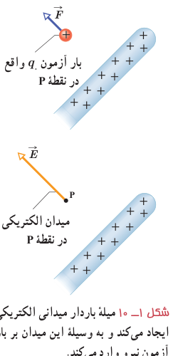
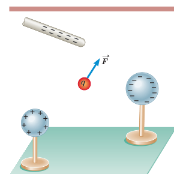

میدان الکتریکی در هر نقطه از فضای اطراف یک جسم باردار الکتریکی به صورت زیر تعیین می‌شود:

نخست بار کوچک و مثبت $q_0$ موسوم به **بار آزمون**¹ را در آن نقطه قرار می‌دهیم و سپس نیروی الکتریکی $\vec F$ وارد بر آن را اندازه می‌گیریم. آن‌گاه میدان الکتریکی $\vec E$ ناشی از جسم باردار در آن نقطه به‌صورت زیر تعریف می‌شود:

$$\vec E=\frac{\vec F}{q_0}\tag{1-3}$$

بنا به تعریف میدان الکتریکی (رابطۀ ۱ـ۳)، میدان الکتریکی کمیتی برداری است که اندازۀ آن برابر $E=F/q_0$ و جهت آن همان جهت نیروی وارد بر بار آزمون است. مثلاً شکل ۱ـ۱۰ قسمتی از میلۀ بارداری را نشان می‌دهد که بر بار آزمون واقع در نقطۀ P نیرو وارد می‌کند. پس میدان در این نقطه، براساس این نیرو تعریف می‌شود.

شکل ۱ـ۱۰ میلۀ باردار میدان الکتریکی ایجاد می‌کند و به وسیلۀ این میدان بر بار آزمون نیرو وارد می‌کند.

در رابطۀ ۱ـ۳ یکای میدان الکتریکی ($\vec E$)، نیوتون بر کولن (N/C) است. بزرگی برخی از میدان‌های الکتریکی در جدول ۱ـ۲ داده شده است.

### جدول ۱ـ۲ بزرگی برخی از مقادیر میدان‌های الکتریکی

| چشمه | بزرگی میدان (N/C) | چشمه | بزرگی میدان (N/C) |
|---|---:|---|---:|
| سیم‌کشی‌های داخل منزل | $10^{-2}$ | در نزدیکی شانۀ باردار | $\approx10^3$ |
| امواج رادیویی | $\approx10^{-1}$ | در نزدیکی فرستندۀ رادار | $7\times10^3$ |
| گوشی همراه | ۳۵–۵۰ | جو (توفان تندری) | $10^4$ |
| ۳۰ سانتی‌متری از یک دستگاه پخش صوت | ۹۰ | در نزدیکی سطح کلاهک مولد واندوگراف | $2\times10^6$ |
| جو (هوای آرام) | $\approx150$ | فرو ریزش الکتریکی در هوا | $3\times10^6$ |
| آفتاب (متوسط) | $10^3$ | در سطح هستۀ اورانیم | $2\times10^{21}$ |

### مثال ۱ـ۵

بار آزمون نشان داده شده در شکل $q_0=+3/0\times10^{-8}\,\mathrm C$ است و از سوی دو گوی و یک میلۀ باردار نیرویی برابر با $F=6/0\times10^{-5}\,\mathrm N$ در جهت نشان داده شده بر آن وارد می‌شود.

الف) میدان الکتریکی در محل بار آزمون را تعیین کنید.

ب) اگر بار $+12\times10^{-8}\,\mathrm C$ را به جای $q_0$ قرار دهیم، چه نیرویی به آن وارد می‌شود؟

۱ـ بار آزمون باید آن‌قدر کوچک باشد که توزیع بار جسم را برهم نزند.
