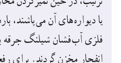

**پاسخ:** الف) بزرگی میدان الکتریکی با استفاده از رابطۀ ۱ـ۳ برابر است با

$$E=\frac F{q_0}=\frac{6/0\times10^{-5}\,\mathrm N}{3/0\times10^{-8}\,\mathrm C}=2/0\times10^3\,\mathrm{N/C}$$

که جهت آن در همان سوی نیروی $\vec F$ نشان داده شده در شکل است.

ب) دوباره با استفاده از رابطۀ ۱ـ۳ داریم:

$$F=q_0E=(12\times10^{-8}\,\mathrm C)(2/0\times10^3\,\mathrm{N/C})=24\times10^{-5}\,\mathrm N$$

جهت این نیرو نیز در همان سوی نیروی $\vec F$ نشان داده شده در شکل است.

### خوب است بدانید: میدان الکتریکی مخازن نفت‌کش‌ها

وقتی آب به سطحی برخورد کند و از آن بپاشد، قطره‌های آب باردار می‌شوند. معمولاً قطره‌های بزرگ‌تر، دارای بار مثبت و قطره‌های کوچک‌تر، دارای بار منفی می‌شوند. قطره‌های بزرگ‌تر نسبتاً سریع فرو می‌افتند و قطره‌های کوچک‌تر که دارای بار منفی‌اند بیشتر در هوا می‌مانند. اگر تهویۀ هوا کم باشد، تعداد قطره‌های موجود در هوا به‌طور چشمگیری افزایش می‌یابد و بدین ترتیب، یک میدان الکتریکی بزرگ (حدود ۸۰۰ N/C) ایجاد می‌شود؛ این وضعیتی است که معمولاً در حمام رخ می‌دهد. به همین ترتیب، در حین تمیز کردن مخازن کشتی‌های نفت‌کش، وقتی قطره‌های آب به صورت افشانه از شیلنگ خارج شده و بر کف مخزن یا دیواره‌های آن می‌پاشند، باردار می‌شوند و در نتیجه مخزن پر از بخار آب باردار می‌شود. ممکن است این ذرات باردار با نوک فلزی آب‌فشان شیلنگ جرقه بزنند. اگر مخزن محتوی بخار نفت خام باشد، این جرقه‌ها می‌توانند بخار را مشتعل کنند و باعث انفجار مخزن گردند. برای رفع این خطر، پیش از تمیز کردن مخزن، یک گاز بی‌اثر به درون آن پمپ می‌شود تا اکسیژن موجود به اندازه‌ای کاهش یابد که از بروز انفجار جلوگیری کند.

## ۱ـ۵ میدان الکتریکی حاصل از یک ذرۀ باردار

می‌خواهیم میدان الکتریکی ناشی از ذره‌ای با بار $q$ را در نقطۀ A که به فاصلۀ $r$ از بار $q$ قرار دارد (شکل ۱ـ۱۱)، محاسبه کنیم. برای این محاسبه از رابطۀ ۱ـ۳ استفاده می‌کنیم. اگر بار آزمون $q_0$ در نقطۀ A قرار گیرد، بار $q$ به آن نیروی $\vec F$ وارد می‌کند. با استفاده از قانون کولن، بزرگی نیروی $\vec F$ را محاسبه می‌کنیم و با جای‌گذاری در رابطۀ $E=F/q_0$، بزرگی میدان الکتریکی بار $q$ را در نقطۀ A به‌دست می‌آوریم:

$$F=k\frac{|q|q_0}{r^2}\qquad\text{و}\qquad E=\frac F{q_0}$$

در نتیجه:

$$E=k\frac{|q|}{r^2}\tag{1-4}$$

رابطۀ ۱ـ۴ عامل‌های مؤثر بر بزرگی میدان الکتریکی حاصل از ذره‌ای با بار $q$ را مشخص می‌کند. طبق این رابطه، میدان با اندازۀ بار $q$، نسبت مستقیم و با مربع فاصله از آن، نسبت وارون دارد. همان‌طور که پیش‌تر دیدیم جهت بردار میدان الکتریکی $\vec E$ در نقطۀ A، همان جهت نیروی وارد بر بار آزمونی است که به‌طور فرضی در نقطۀ A می‌گذاریم.

شکل ۱ـ۱۱ می‌خواهیم میدان حاصل از ذرۀ باردار $q$ را در نقطۀ A محاسبه کنیم.
