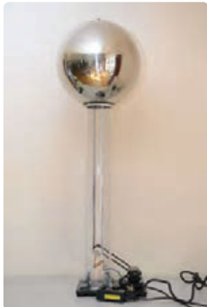
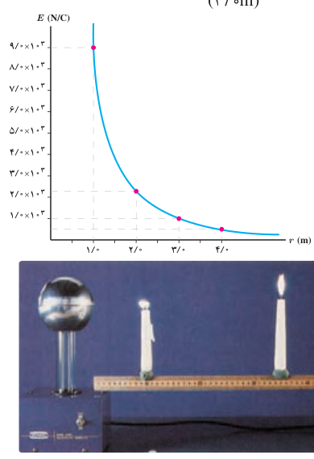

### مثال ۱ـ۶

مولد وان دوگراف¹ وسیله‌ای است که با استفاده از تسمه‌ای متحرک، بار الکتریکی را بر روی یک کلاهک توخالی فلزی جمع می‌کند. فرض کنید کلاهک این مولد، کره‌ای با شعاع $0/10\,\mathrm m$ است و باری به بزرگی $1/0\,\mu\mathrm C$ روی آن جمع می‌شود. با فرض آنکه همۀ این بار در مرکز کره قرار داشته باشد، بزرگی میدان الکتریکی این بار را در فاصله‌های $1/0\,\mathrm m$، $2/0\,\mathrm m$، $3/0\,\mathrm m$ و $4/0\,\mathrm m$ از مرکز کره به‌دست آورید و سپس با نقطه‌یابی، نمودار بزرگی میدان الکتریکی را برحسب فاصله از مرکز کره رسم کنید.

**پاسخ:** با استفاده از رابطۀ ۱ـ۴ بزرگی میدان را در نقطه‌های مورد نظر به‌دست می‌آوریم:

$$E=k\frac{|q|}{r^2}$$
$$E_1=(9/0\times10^9\,\mathrm{N.m^2/C^2})\frac{1/0\times10^{-6}\,\mathrm C}{(1/0\,\mathrm m)^2}=9/0\times10^3\,\mathrm{N/C}$$
$$E_2=(9/0\times10^9\,\mathrm{N.m^2/C^2})\frac{1/0\times10^{-6}\,\mathrm C}{(2/0\,\mathrm m)^2}=2/25\times10^3\,\mathrm{N/C}\approx2/3\times10^3\,\mathrm{N/C}$$
$$E_3=(9/0\times10^9\,\mathrm{N.m^2/C^2})\frac{1/0\times10^{-6}\,\mathrm C}{(3/0\,\mathrm m)^2}=1/0\times10^3\,\mathrm{N/C}$$
$$E_4=(9/0\times10^9\,\mathrm{N.m^2/C^2})\frac{1/0\times10^{-6}\,\mathrm C}{(4/0\,\mathrm m)^2}=0/5625\times10^3\,\mathrm{N/C}\approx0/56\times10^3\,\mathrm{N/C}$$

با استفاده از این نتایج نمودار $E$ برحسب $r$، مانند نمودار روبه‌رو خواهد شد.

برای مشاهدۀ تجربی نتایج مثال ۱ـ۶ می‌توان به آزمایش شکل زیر توجه کرد. در این شکل، دو شمع یکی در فاصله‌ای نزدیک و دیگری در فاصله‌ای دور از کلاهک یک مولد وان‌دوگراف قرار گرفته‌اند. همان‌طور که مشاهده می‌کنید شعلۀ شمع نزدیک‌تر به سمت کلاهک کشیده شده است، در حالی که شعلۀ شمع دورتر تغییر چندانی نکرده است. دلیل آن است که کلاهک این مولد وان‌دوگراف بار منفی بزرگی دارد که یون‌های مثبت شعلۀ شمع نزدیک‌تر را به سمت خود می‌کشد، در حالی که شمع دیگر در فاصلۀ دوری از کلاهک قرار گرفته است که تحت تأثیر میدان الکتریکی ضعیف‌تری قرار می‌گیرد.

۱ـ Van de Graaff generator
