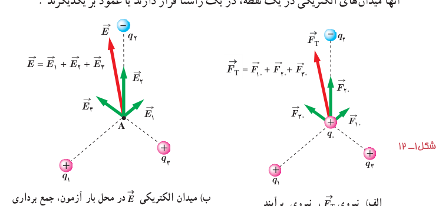

### تمرین ۱ـ۴

طبق مدل بور برای اتم هیدروژن، در حالت پایه فاصلۀ الکترون از پروتون هسته برابر با $5/3\times10^{-11}\,\mathrm m$ است.

الف) اندازۀ میدان الکتریکی ناشی از پروتون هسته را در این فاصله تعیین کنید.

ب) در چه فاصله‌ای از پروتون هسته، بزرگی میدان الکتریکی برابر با بزرگی میدان الکتریکی حاصل از مولد وان‌دوگراف مثال پیش در فاصلۀ $1/0\,\mathrm m$ از مرکز کلاهک آن است؟

**برهم‌نهی میدان‌های الکتریکی:** اگر چند بار الکتریکی ذره‌ای داشته باشیم، میدان الکتریکی ناشی از این بارها، در نقطه‌ای از فضا چگونه تعیین می‌شود؟ در بخش ۱ـ۴ دیدیم اگر چند بار نقطه‌ای مانند $q_1$، $q_2$، ... داشته باشیم نیروی الکتریکی برآیند حاصل از این بارها بر بار آزمون $q_0$ با استفاده از اصل برهم‌نهی نیروهای کولنی از رابطۀ زیر به‌دست می‌آید:

$$\vec F_T=\vec F_{10}+\vec F_{20}+\cdots$$

حال اگر بخواهیم میدان الکتریکی را در محل بار آزمون به‌دست آوریم، با استفاده از تعریف میدان الکتریکی ($\vec E=\vec F/q_0$) دو طرف معادلۀ بالا را بر $q_0$ تقسیم می‌کنیم. آن‌گاه خواهیم داشت:

$$\frac{\vec F_T}{q_0}=\frac{\vec F_{10}}{q_0}+\frac{\vec F_{20}}{q_0}+\cdots$$
$$\vec E=\vec E_1+\vec E_2+\cdots\tag{1-5}$$

این رابطه که موسوم به **اصل برهم‌نهی میدان‌های الکتریکی** است، نشان می‌دهد که میدان الکتریکی ناشی از چند بار الکتریکی در نقطه‌ای از فضا، برابر مجموع میدان‌هایی است که هر بار در نبود سایر بارها در آن نقطه از فضا ایجاد می‌کند؛ یعنی برای یافتن میدان الکتریکی خالص حاصل از چند ذرۀ باردار در نقطه‌ای از فضا باید نخست میدان الکتریکی ناشی از هر ذره را در آن نقطه به‌دست آورد و سپس این میدان‌ها را به صورت برداری با یکدیگر جمع کرد. مثلاً شکل ۱ـ۱۲ـ ب میدان الکتریکی خالص در محل بار آزمون را نشان می‌دهد. در این کتاب، صرفاً مثال‌هایی را بررسی می‌کنیم که در آنها میدان‌های الکتریکی در یک نقطه، در یک راستا قرار دارند یا عمود بر یکدیگرند.¹

شکل ۱ـ۱۲ الف) نیروی $\vec F_T$، نیروی برآیند وارد بر بار آزمون $q_0$ است. ب) میدان الکتریکی $\vec E$ در محل بار آزمون، جمع برداری میدان‌های $\vec E_1$، $\vec E_2$ و $\vec E_3$ در محل این بار است.

۱ـ بررسی حالت‌هایی که میدان‌ها هم‌راستا و یا عمود برهم نیستند، خارج از برنامۀ درسی این کتاب بوده و نباید مورد ارزشیابی قرار گیرد.
