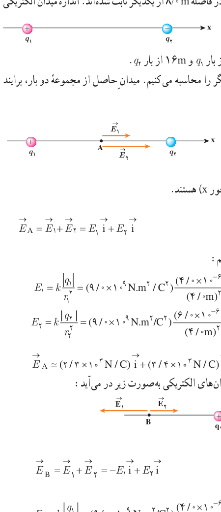

### مثال ۱ـ۷

مطابق شکل، دو ذره با بارهای $q_1=4/0\,\mu\mathrm C$ و $q_2=-6/0\,\mu\mathrm C$ در فاصلۀ $8/0\,\mathrm m$ از یکدیگر ثابت شده‌اند. اندازۀ میدان الکتریکی خالص را در نقطه‌های زیر به‌دست آورید:

الف) در وسط خط واصل دو ذره،

ب) در نقطه‌ای روی خط واصل دو ذره به فاصلۀ $8/0\,\mathrm m$ از بار $q_1$ و $16\,\mathrm m$ از بار $q_2$.

**پاسخ:** در غیاب هر یک از دو ذره، میدان حاصل از بار دیگر را محاسبه می‌کنیم. میدان حاصل از مجموعۀ دو بار، برآیند این دو میدان خواهد بود.

الف) در شکل اگر بار آزمون را در نقطۀ A واقع در وسط خط واصل دو ذره قرار دهیم، بار $q_1$ آن را دفع و بار $q_2$ آن را جذب می‌کند. بنابراین، همان‌طور که شکل نشان می‌دهد، $\vec E_1$ و $\vec E_2$ در نقطۀ A هم‌جهت و به سوی بار $q_2$ (در سوی مثبت محور $x$) هستند. بنا بر اصل برهم‌نهی میدان‌های الکتریکی داریم:

$$\vec E_A=\vec E_1+\vec E_2=E_1\vec i+E_2\vec i$$

مقادیر $E_1$ و $E_2$ را با استفاده از رابطۀ ۱ـ۴ به‌دست می‌آوریم:

$$E_1=k\frac{|q_1|}{r_1^2}=(9/0\times10^9\,\mathrm{N.m^2/C^2})\frac{4/0\times10^{-6}\,\mathrm C}{(4/0\,\mathrm m)^2}=2/25\times10^3\,\mathrm{N/C}\approx2/3\times10^3\,\mathrm{N/C}$$
$$E_2=k\frac{|q_2|}{r_2^2}=(9/0\times10^9\,\mathrm{N.m^2/C^2})\frac{6/0\times10^{-6}\,\mathrm C}{(4/0\,\mathrm m)^2}=3/375\times10^3\,\mathrm{N/C}\approx3/4\times10^3\,\mathrm{N/C}$$

بنابراین:

$$\vec E_A\approx(2/3\times10^3\,\mathrm{N/C})\vec i+(3/4\times10^3\,\mathrm{N/C})\vec i=(5/7\times10^3\,\mathrm{N/C})\vec i$$

ب) اکنون اگر بار آزمون را در نقطۀ B قرار دهیم شکل میدان‌های الکتریکی به‌صورت زیر در می‌آید. با استفاده از اصل برهم‌نهی میدان‌های الکتریکی داریم:

$$\vec E_B=\vec E_1+\vec E_2=-E_1\vec i+E_2\vec i$$

که در آن $E_1$ و $E_2$ برابرند با

$$E_1=k\frac{|q_1|}{r_1^2}=(9/0\times10^9\,\mathrm{N.m^2/C^2})\frac{4/0\times10^{-6}\,\mathrm C}{(8/0\,\mathrm m)^2}=5/625\times10^2\,\mathrm{N/C}\approx5/6\times10^2\,\mathrm{N/C}$$
$$E_2=k\frac{|q_2|}{r_2^2}=(9/0\times10^9\,\mathrm{N.m^2/C^2})\frac{6/0\times10^{-6}\,\mathrm C}{(16\,\mathrm m)^2}=2/109\times10^2\,\mathrm{N/C}\approx2/1\times10^2\,\mathrm{N/C}$$

بنابراین:

$$\vec E_B\approx(-5/6\times10^2\,\mathrm{N/C})\vec i+(2/1\times10^2\,\mathrm{N/C})\vec i=(-3/5\times10^2\,\mathrm{N/C})\vec i$$
