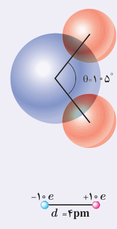
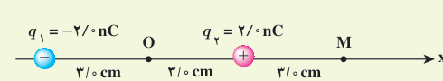
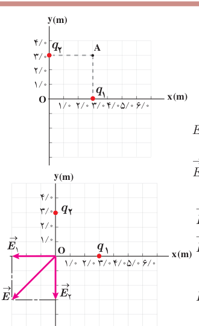

### خوب است بدانید

**دوقطبی الکتریکی** آرایشی از بارهای الکتریکی است که در آن دو ذره با بزرگی بار $q$ یکسان و علامت مخالف در فاصلۀ $d$ از هم روی محوری که به آن محور دوقطبی گفته می‌شود قرار گرفته‌اند. مولکول آب ($\mathrm{H_2O}$) از دو اتم هیدروژن و یک اتم اکسیژن ساخته شده است. اتم اکسیژن ۱۰ الکترون موجود در مولکول را به سمت خود می‌کشد و بدین ترتیب اتم‌های هیدروژن بار مثبت و خودش بار منفی پیدا می‌کند. این سه اتم مطابق شکل به گونه‌ای قرار گرفته‌اند که خطوط وصل‌کنندۀ مراکز اتم‌های هیدروژن به مرکز اتم اکسیژن، زاویۀ ۱۰۵° با یکدیگر می‌سازند. اندازه‌گیری و محاسبه نشان می‌دهد میدان الکتریکی ایجاد شده به‌وسیلۀ مولکول آب به‌گونه‌ای است که می‌توان فرض کرد کل بار $+10e$ پروتون‌های مولکول و کل بار $-10e$ الکترون‌های مولکول به شکل دو بار نقطه‌ای و در فاصلۀ $4\,\mathrm{pm}$ از هم قرار گرفته‌اند و همچون یک دوقطبی الکتریکی ایجاد میدان الکتریکی می‌کنند. بررسی میدان الکتریکی دوقطبی و نیز اثر میدان الکتریکی خارجی بر دوقطبی، اهمیت زیادی در شناخت رفتار الکتریکی مولکول‌های قطبی (مانند مولکول آب) در میدان‌های الکتریکی دارد.

### تمرین ۱ـ۵

شکل زیر، آرایشی از دو بار الکتریکی هم‌اندازه و غیرهمنام (دوقطبی الکتریکی) را نشان می‌دهد که در آن فاصلۀ دو بار از هم $6/0\,\mathrm{cm}$ است. میدان الکتریکی خالص را در نقطه‌های O و M به‌دست آورید.

### مثال ۱ـ۸

شکل روبه‌رو، دو بار نقطه‌ای $q_1$ و $q_2$ را در صفحۀ xy نشان می‌دهد. میدان الکتریکی خالص را در نقطۀ O (مبدأ مختصات) تعیین کنید. ($q_1=q_2=5/0\,\mu\mathrm C$)

**پاسخ:** در نقطۀ O میدان‌های الکتریکی مانند شکل زیر می‌شوند؛ چون بارها با هم برابر و فاصلۀ آنها تا نقطۀ O نیز یکسان است، پس اندازۀ میدان‌ها در این نقطه با هم برابرند:

$$E_1=E_2=k\frac{|q|}{r^2}=(9/0\times10^9\,\mathrm{N.m^2/C^2})\frac{5/0\times10^{-6}\,\mathrm C}{(3/0\,\mathrm m)^2}=5/0\times10^3\,\mathrm{N/C}$$
$$\vec E_1=(-5/0\times10^3\,\mathrm{N/C})\vec i\qquad\text{و}\qquad\vec E_2=(-5/0\times10^3\,\mathrm{N/C})\vec j$$

در نتیجه میدان الکتریکی خالص برابر است با

$$\vec E=\vec E_1+\vec E_2=(-5/0\times10^3\,\mathrm{N/C})\vec i+(-5/0\times10^3\,\mathrm{N/C})\vec j$$

و از آنجا اندازۀ میدان الکتریکی خالص چنین می‌شود:

$$E=\sqrt{(-5/0\times10^3\,\mathrm{N/C})^2+(-5/0\times10^3\,\mathrm{N/C})^2}=7/07\times10^3\,\mathrm{N/C}\approx7/1\times10^3\,\mathrm{N/C}$$
