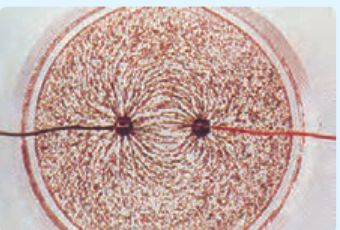
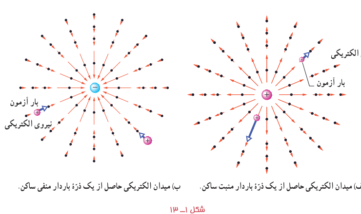

### تمرین ۱ـ۶

میدان الکتریکی خالص حاصل از آرایش بار مثال ۱ـ۸ را در نقطۀ A تعیین کنید.

## ۱ـ۶ خطوط میدان الکتریکی

پیش از این دیدیم بارهای الکتریکی در فضای پیرامون خود میدان الکتریکی ایجاد می‌کنند. آیا می‌توانید بردار میدان الکتریکی را در نقاط پیرامون یک ذرۀ باردار مثبت یا منفی تجسم کنید؟ مایکل فاراده نخستین بار در میانۀ قرن نوزدهم میلادی روشی را برای تجسم این بردارها ارائه کرد. برای مجسم کردن میدان الکتریکی در فضای اطراف اجسام باردار از خط‌های جهت‌داری موسوم به خطوط میدان الکتریکی استفاده می‌کنیم.

### فعالیت ۱ـ۳ (کار در کلاس)

درون یک ظرف شیشه‌ای یا پلاستیکی با عمق کم، مقداری پارافین مایع یا روغن کرچک به عمق حدود $0/5\,\mathrm{cm}$ بریزید و داخل آن دو الکترود نقطه‌ای قرار دهید. الکترودها را با سیم به پایانه‌های مثبت و منفی یک مولد ولتاژ بالا، مانند مولد وان‌دوگراف وصل کنید. روی سطح پارافین، مقدار کمی بذر چمن یا خاکشیر بپاشید. مولد را روشن کنید. اکنون به سمت‌گیری دانه‌ها در فضای بین دو الکترود توجه کنید. شکل سمت‌گیری دانه‌ها در این فضا را رسم کنید.

اگر یک بار آزمون را در نزدیکی یک ذرۀ باردار مثبت یا منفی قرار دهیم، بسته به نوع بار، نیروی الکتریکی وارد به بار آزمون در جهت دور شدن از ذره (شکل ۱ـ۱۳ـ الف) و یا در جهت نزدیک شدن به آن (شکل ۱ـ۱۳ـ ب) خواهد بود.

شکل ۱ـ۱۳ الف) میدان الکتریکی حاصل از یک ذرۀ باردار مثبت ساکن. ب) میدان الکتریکی حاصل از یک ذرۀ باردار منفی ساکن.
