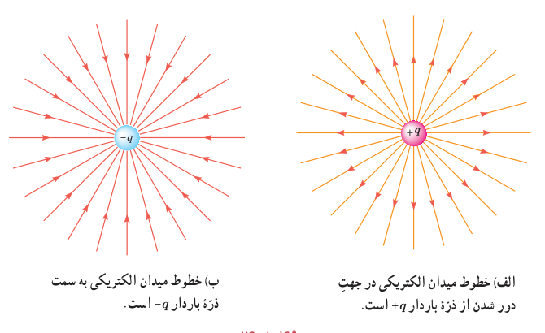
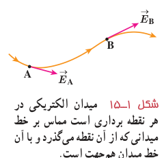
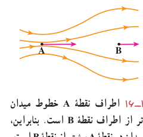
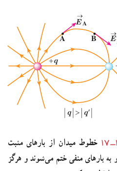
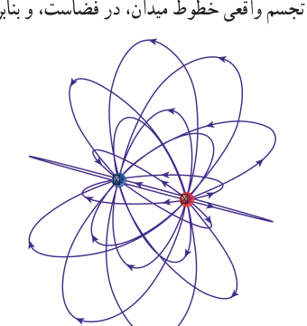

خط‌های میدان در هر نقطه، هم‌جهت با بردار میدان الکتریکی در آن نقطه است (شکل ۱ـ۱۴).

شکل ۱ـ۱۴ الف) خطوط میدان الکتریکی در جهت دور شدن از ذرۀ باردار $+q$ است. ب) خطوط میدان الکتریکی به سمت ذرۀ باردار $-q$ است.

بنابراین، طرحی که از سمت‌گیری دانه‌ها در فعالیت ۱ـ۳ دیدید، در واقع طرحی از خطوط میدان الکتریکی در فضای بین دو الکترود بوده است.

قاعده‌های رسم خطوط میدان الکتریکی عبارت‌اند از:

۱ـ در هر نقطه، بردار میدان الکتریکی باید مماس بر خط میدان الکتریکی عبوری از آن نقطه و در همان جهت باشد (شکل ۱ـ۱۵).

۲ـ میزان تراکم خطوط میدان در هر ناحیه از فضا نشان‌دهندۀ اندازۀ میدان در آن ناحیه است؛ هرجا خطوط میدان متراکم‌تر باشد، اندازۀ میدان بیشتر است (شکل ۱ـ۱۶).

۳ـ در آرایشی از بارها خطوط میدان الکتریکی از بارهای مثبت شروع و به بارهای منفی ختم می‌شوند.

۴ـ خطوط میدان برآیند هرگز یکدیگر را قطع نمی‌کنند (شکل ۱ـ۱۷) یعنی از هر نقطۀ فضا فقط یک خط میدان الکتریکی می‌گذرد.

تجسم واقعی خطوط میدان، در فضاست، و بنابراین طرحی سه‌بعدی دارد (شکل ۱ـ۱۸).

شکل ۱ـ۱۵ میدان الکتریکی در هر نقطه برداری است مماس بر خط میدانی که از آن نقطه می‌گذرد و با آن خط میدان هم‌جهت است.

شکل ۱ـ۱۶ اطراف نقطۀ A خطوط میدان متراکم‌تر از اطراف نقطۀ B است. بنابراین، بزرگی میدان در نقطۀ A بیشتر از نقطۀ B است.

شکل ۱ـ۱۷ خطوط میدان از بارهای مثبت شروع و به بارهای منفی ختم می‌شوند و هرگز یکدیگر را قطع نمی‌کنند.

شکل ۱ـ۱۸ نمایش سه‌بعدی خطوط میدان برای یک دوقطبی الکتریکی.
