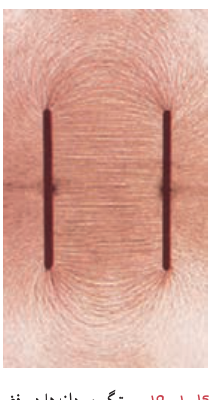
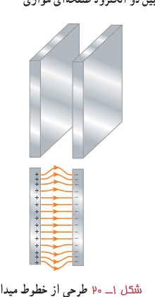
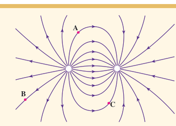

### پرسش ۱ـ۴

به نظر شما چرا خطوط میدان الکتریکی برآیند هرگز یکدیگر را قطع نمی‌کنند؟

**میدان الکتریکی یکنواخت:** اگر دوباره اسباب فعالیت ۱ـ۳ را سوار کنید و این بار الکترودهای نقطه‌ای را با دو صفحۀ فلزی موازی جایگزین کنید و دوباره به سمت‌گیری دانه‌ها در فضای بین دو الکترود توجه کنید، طرحی از خطوط میدان الکتریکی را مشاهده می‌کنید که در شکل ۱ـ۱۹ نشان داده شده است. خطوط این میدان در فضای بین دو صفحه و دور از لبه‌های صفحات، مستقیم، موازی و هم‌فاصله‌اند؛ یعنی بردار میدان در این نقاط هم‌اندازه و هم‌جهت است. به چنین میدانی، میدان الکتریکی یکنواخت گفته می‌شود (شکل ۱ـ۲۰).

شکل ۱ـ۱۹ سمت‌گیری دانه‌ها در فضای بین دو الکترود صفحه‌ای موازی.

شکل ۱ـ۲۰ طرحی از خطوط میدان یکنواخت بین دو صفحۀ رسانای موازی با بارهای هم‌اندازه و ناهمنام.

**نیروی الکتریکی وارد بر بار الکتریکی در یک میدان الکتریکی:** گرچه برای تعریف میدان الکتریکی یک جسم باردار از بار آزمون مثبت استفاده کردیم، ولی وجود این میدان مستقل از بار آزمون است. بنابراین، اگر بار الکتریکی ذره‌ای $q$ در میدان الکتریکی $\vec E$ ناشی از اجسام باردار دیگری قرار گیرد، این میدان بر آن نیروی $\vec F$ را وارد می‌کند. نیروی $\vec F$ از رابطۀ زیر به‌دست می‌آید:

$$\vec F=q\vec E\tag{1-6}$$

بزرگی این نیرو از رابطۀ $F=|q|E$ به‌دست می‌آید، و جهت آن اگر $q$ مثبت باشد، در همان جهت $\vec E$ و اگر $q$ منفی باشد، در خلاف جهت $\vec E$ خواهد بود.

### پرسش ۱ـ۵

بار $-q$ را در نقطه‌های A، B و C از میدان الکتریکی غیریکنواخت شکل روبه‌رو قرار دهید و جهت نیروی الکتریکی وارد بر این بار منفی را تعیین کنید.

### فعالیت ۱ـ۴

تولیدمثل برخی از گل‌ها به زنبورهای عسل وابسته است. گرده‌ها به واسطۀ میدان الکتریکی، از یک گل به زنبور و از زنبور به گل دیگر منتقل می‌شوند. در این باره تحقیق کنید.

