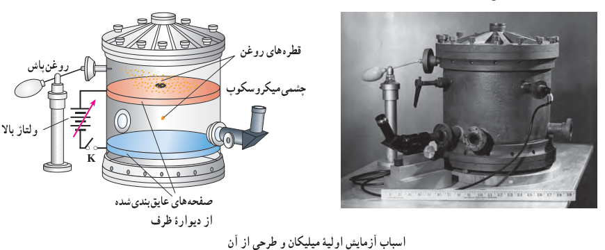

### مثال ۱ـ۹: آزمایش قطره ـ روغن میلیکان

همان‌طور که پیش‌تر دیدیم بار الکتریکی با هر مقداری ظاهر نمی‌شود؛ بلکه همواره مضرب درستی از بار بنیادی $e$ است ($q=\pm ne$). آزمایش کلاسیک فیزیک‌دان امریکایی رابرت میلیکان به توضیح این امر می‌پردازد. این آزمایش اکنون به نام آزمایش قطره ـ روغن میلیکان¹ معروف است. میلیکان بین دو ورقۀ فلزی موازی و افقی میدان الکتریکی قائم یکنواخت $\vec E$ را توسط یک منبع ولتاژ بالا ایجاد کرد (که می‌توانست آن را قطع و وصل کند). او در مرکز ورقۀ بالایی چندین روزنۀ کوچک ایجاد کرده بود که از طریق آنها قطره‌های روغن حاصل از یک روغن‌پاش به ناحیۀ بین دو ورقه می‌پاشید. بیشتر این قطره‌ها در اثر مالش با دهانۀ خروجی روغن‌پاش، باردار می‌شدند. میلیکان با تغییر دادن میدان الکتریکی بین صفحات به حرکت قطره‌های روغن در این فضا توجه کرد و با تحلیل این حرکت و با در نظر گرفتن مقاومت هوا، نیروی الکتریکی وارد بر هر قطره را محاسبه کرد و از آنجا بار الکتریکی هر قطره را تعیین کرد. میلیکان با تکرار آزمایش قطره ـ روغن به دفعات زیاد و با قطره‌روغن‌های متفاوت دریافت که بار قطره‌ها برابر بار بنیادی $e$ یا مضرب درستی از این مقدار است. شکل زیر اسباب واقعی آزمایش اولیۀ میلیکان و طرحی از آن اسباب را نشان می‌دهد.

اکنون وضعیتی را در نظر بگیرید که قطرۀ روغن در فضای بین دو صفحه معلق است. اگر جرم این قطرۀ روغن $8/2\times10^{-15}\,\mathrm{kg}$ و میدان الکتریکی دارای بزرگی $1/0\times10^5\,\mathrm{N/C}$ و رو به پایین باشد، تعداد الکترون‌هایی که قطره جذب کرده یا از دست داده است، چقدر است؟

**پاسخ:** چون قطرۀ روغن در میدان الکتریکی معلق است و وزن همواره رو به پایین اثر می‌کند، بنابراین، نیروی الکتریکی باید مطابق شکل رو به بالا بر قطرۀ روغن اثر کند. چون جهت نیروی الکتریکی رو به بالا و جهت میدان الکتریکی رو به پایین است، نتیجه می‌گیریم که بار قطرۀ روغن باید منفی باشد؛ یعنی باید قطرۀ روغن الکترون به‌دست آورده باشد. حال به دنبال تعداد الکترون‌هایی هستیم که این قطره به‌دست آورده است. از شرط تعادل نیروها داریم:

$$\text{نیروی الکتریکی}=\text{وزن}\Rightarrow |q|E=mg$$

### رابرت اندروز میلیکان² (۱۸۶۸–۱۹۵۳م)

فیزیک‌دان خبرۀ امریکایی که در سال ۱۹۲۳ میلادی به خاطر کار خود در تعیین بار الکترون و نیز اثر فوتوالکتریک برندۀ جایزۀ نوبل گردید.

۱ـ Millikan’s Oil-drop Experiment  
۲ـ Robert Andrews Millikan
