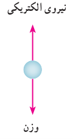
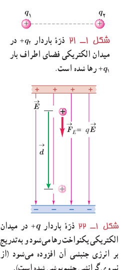

و در نتیجه

$$|q|=\frac{mg}{E}=\frac{(8/2\times10^{-15}\,\mathrm{kg})(9/8\,\mathrm{N/kg})}{1/0\times10^5\,\mathrm{N/C}}\approx8/0\times10^{-19}\,\mathrm C$$

از طرفی می‌دانیم $|q|=ne$ است. در نتیجه

$$n=\frac{8/0\times10^{-19}\,\mathrm C}{1/60\times10^{-19}\,\mathrm C}=5$$

بنابراین، قطرۀ روغن ۵ الکترون به‌دست آورده است.

### تمرین ۱ـ۷

روی سطح بادکنکی به جرم $10/0\,\mathrm g$ بار الکتریکی $-200\,\mathrm{nC}$ ایجاد می‌کنیم و آن را در یک میدان الکتریکی قرار می‌دهیم. بزرگی و جهت این میدان الکتریکی را در صورتی که بادکنک معلق بماند، تعیین کنید. اندازۀ نیروی شناوری رو به بالای وارد بر بادکنک را $0/050\,\mathrm N$ فرض کنید.

### فعالیت ۱ـ۵

رسوب‌دهندۀ الکتروستاتیکی¹ (ESP) دود و غبار را از گازهای زائدی که از دودکش کارخانه‌ها و نیروگاه‌ها بالا می‌آید جدا می‌سازد. رسوب‌دهنده‌ها انواع مختلفی دارند. در مورد اساس کار این رسوب‌دهنده‌ها تحقیق کنید. شکل‌های روبه‌رو تأثیر رسوب‌دهنده را در کاهش آلودگی هوای ناشی از یک دودکش نشان می‌دهد.

## ۱ـ۷ انرژی پتانسیل الکتریکی

دو ذرۀ باردار الکتریکی شکل ۱ـ۲۱ را در نظر بگیرید که در آن، بار $+q_1$ در جای خود ثابت و بار $+q_2$ در فضای اطراف آن رها شده است. می‌دانیم بار $+q_2$ بر اثر میدان الکتریکی حاصل از بار $+q_1$ از آن رانده و دارای انرژی جنبشی می‌شود. طبق قانون پایستگی انرژی، انرژی جنبشی نمی‌تواند خود به خود به‌وجود آمده باشد. به نظر شما این انرژی جنبشی از کجا آمده است؟ این انرژی، ناشی از تغییر (در اینجا کاهش) انرژی پتانسیلی است که به نیروی الکتریکی بین دو ذرۀ شکل ۱ـ۲۱ وابسته است و همان‌طور که در کتاب فیزیک سال دهم دیدید به آن **انرژی پتانسیل الکتریکی** می‌گوییم. برای آنکه به توصیفی کمّی از این انرژی دست یابیم، میدان الکتریکی یکنواختی را مطابق شکل ۱ـ۲۲ در نظر می‌گیریم که در فضای میان دو صفحۀ باردار برقرار شده است.

اگر بار الکتریکی $+q$ را از مجاورت صفحۀ مثبت رها کنیم، تحت تأثیر میدان الکتریکی (با چشم‌پوشی از گرانش)، به طرف صفحۀ منفی شروع به حرکت می‌کند و به تدریج تندی و انرژی جنبشی آن افزایش می‌یابد. این وضعیت، شبیه چیزی است که در کتاب فیزیک سال دهم دیدیم. در آنجا نیز مشاهده کردیم که وقتی جسمی به جرم $m$ از ارتفاع $h$ رها می‌شود، جسم رو به پایین حرکت کرده و انرژی جنبشی

شکل ۱ـ۲۱ ذرۀ باردار $+q_2$ در میدان الکتریکی فضای اطراف بار $+q_1$ رها شده است. شکل ۱ـ۲۲ ذرۀ باردار $+q$ در میدان الکتریکی یکنواخت رها می‌شود و به‌تدریج بر انرژی جنبشی آن افزوده می‌شود (از نیروی گرانشی چشم‌پوشی شده است).

۱ـ Electrostatic Precipitator
