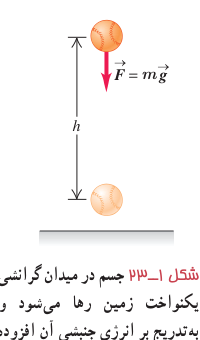
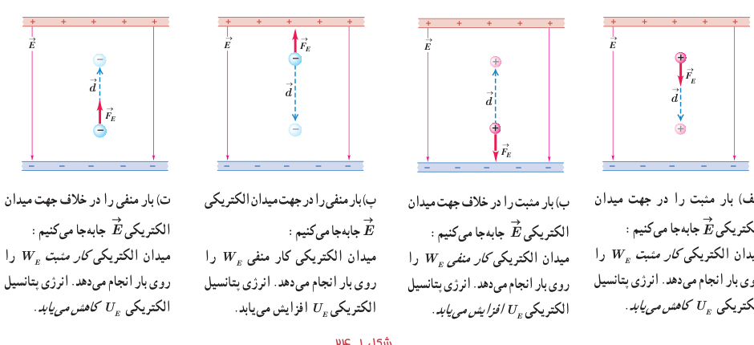

آن بر اثر کاهش انرژی پتانسیل گرانشی به‌تدریج افزایش می‌یابد (شکل ۱ـ۲۳). همچنین دیدیم که کار نیروی گرانشی برابر با منفی تغییر انرژی پتانسیل گرانشی است ($W_g=-\Delta U_g$).

در اینجا نیز می‌توان گفت: کار نیروی الکتریکی وارد بر یک ذرۀ باردار در میدان الکتریکی یکنواخت $\vec E$ در یک جابه‌جایی مشخص برابر با منفی تغییر انرژی پتانسیل الکتریکی در همان جابه‌جایی است؛ یعنی:

$$W_E=-\Delta U_E\tag{1-7}$$

گرچه این رابطه برای یک میدان الکتریکی یکنواخت بیان شد، ولی می‌توان نشان داد که در حالت کلی نیز برای هر میدان الکتریکی برقرار است.

بار ذره‌ای $q$ را در میدان الکتریکی یکنواخت $\vec E$ در نظر بگیرید که جابه‌جایی $\vec d$ را موازی میدان الکتریکی، انجام می‌دهد (شکل ۱ـ۲۲). طبق تعریف کار که در سال قبل دیدید، کار انجام‌شده توسط نیروی الکتریکی ثابت $\vec F_E$ در طی جابه‌جایی $\vec d$ از رابطۀ زیر به‌دست می‌آید:

$$W_E=(F_E\cos\theta)d=F_Ed\cos\theta$$

با توجه به اینکه $F_E=|q|E$ است، این رابطه به‌صورت زیر می‌شود:

$$W_E=|q|Ed\cos\theta$$

اکنون با استفاده از رابطۀ ۱ـ۷ تغییر انرژی پتانسیل الکتریکی بار ذره‌ای $q$ چنین محاسبه می‌شود:

$$\Delta U_E=-W_E=-|q|Ed\cos\theta\tag{1-8}$$

که در آن، $\theta$ زاویۀ بین نیروی $\vec F_E$ و جابه‌جایی $\vec d$ است. (در این کتاب، در استفاده از رابطۀ ۱ـ۸، صرفاً با جابه‌جایی‌های هم‌راستا با میدان الکتریکی و یا عمود بر میدان الکتریکی سروکار خواهیم داشت.) در این رابطه، بار الکتریکی ($q$) برحسب کولن (C)، بزرگی میدان الکتریکی ($E$) برحسب نیوتون بر کولن (N/C)، اندازۀ جابه‌جایی ($d$) برحسب متر (m) و تغییر انرژی پتانسیل الکتریکی ($\Delta U_E$) برحسب ژول (J) است. توجه کنید که این رابطه چه برای بار ذرۀ مثبت و چه برای بار ذرۀ منفی برقرار است.

شکل ۱ـ۲۳ جسم در میدان گرانشی یکنواخت زمین رها می‌شود و به‌تدریج بر انرژی جنبشی آن افزوده می‌شود.

شکل ۱ـ۲۴: الف) بار مثبت را در جهت میدان الکتریکی $\vec E$ جابه‌جا می‌کنیم: میدان الکتریکی کار مثبت $W_E$ را روی بار انجام می‌دهد. انرژی پتانسیل الکتریکی $U_E$ کاهش می‌یابد. ب) بار مثبت را در خلاف جهت میدان جابه‌جا می‌کنیم: میدان الکتریکی کار منفی $W_E$ را روی بار انجام می‌دهد. انرژی پتانسیل الکتریکی افزایش می‌یابد. پ) بار منفی را در جهت میدان الکتریکی جابه‌جا می‌کنیم: میدان الکتریکی کار منفی روی بار انجام می‌دهد. انرژی پتانسیل الکتریکی افزایش می‌یابد. ت) بار منفی را در خلاف جهت میدان الکتریکی جابه‌جا می‌کنیم: میدان الکتریکی کار مثبت روی بار انجام می‌دهد. انرژی پتانسیل الکتریکی کاهش می‌یابد.
