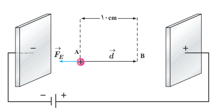
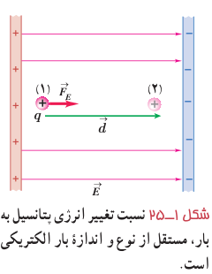

### مثال ۱ـ۱۰

در یک میدان الکتریکی یکنواخت $E=2/0\times10^3\,\mathrm{N/C}$، پروتونی از نقطۀ A با سرعت $\vec v_0$ در خلاف جهت میدان الکتریکی پرتاب شده است. پروتون سرانجام در نقطۀ B متوقف می‌شود. بار پروتون $1/6\times10^{-19}\,\mathrm C$ و جرم آن $1/67\times10^{-27}\,\mathrm{kg}$ است.

الف) تغییر انرژی پتانسیل الکتریکی پروتون در این جابه‌جایی چقدر است؟

ب) تندی پرتاب پروتون را پیدا کنید (از وزن پروتون و مقاومت هوا چشم‌پوشی شود).

**پاسخ:** الف) با توجه به رابطۀ ۱ـ۸ داریم:

$$\Delta U_E=-W_E=-|q|Ed\cos\theta=-(1/6\times10^{-19}\,\mathrm C)(2/0\times10^3\,\mathrm{N/C})(10\times10^{-2}\,\mathrm m)(\cos180^\circ)=3/2\times10^{-17}\,\mathrm J$$

ب) طبق قضیۀ کار ـ انرژی جنبشی می‌توان نوشت:

$$W_E=\Delta K\Rightarrow-\Delta U_E=\frac12m(0-v_0^2)$$
$$-3/2\times10^{-17}\,\mathrm J=\frac12(1/67\times10^{-27}\,\mathrm{kg})(-v_0^2)\Rightarrow v_0=1/96\times10^5\,\mathrm{m/s}\approx2/0\times10^5\,\mathrm{m/s}$$

### تمرین ۱ـ۸

در مثال ۱ـ۱۰ اگر جای قطب‌های باتری عوض شود و پروتون را در نقطۀ A از حالت سکون رها کنیم، پروتون با چه تندی‌ای به نقطۀ B می‌رسد؟

## ۱ـ۸ پتانسیل الکتریکی

در بخش قبل دیدیم تغییر انرژی پتانسیل الکتریکی یک ذرۀ باردار به بار الکتریکی آن بستگی دارد؛ مثلاً با دو برابر شدن بار ذره، تغییر انرژی پتانسیل الکتریکی آن نیز دو برابر می‌شود. بنابراین، نسبت تغییر انرژی پتانسیل به بار ذره، مستقل از نوع و اندازۀ بار الکتریکی است. به این نسبت، **اختلاف پتانسیل الکتریکی** دو نقطه‌ای می‌گوییم که ذره میان آنها جابه‌جا شده است (شکل ۱ـ۲۵) و آن را با $\Delta V$ نمایش می‌دهیم:

$$\Delta V=V_2-V_1=\frac{\Delta U_E}{q}\tag{1-9}$$

که در آن $V$ کمیتی نرده‌ای موسوم به پتانسیل الکتریکی است که مقدار آن در نقطه‌های ۱ و ۲ به ترتیب $V_1$ و $V_2$ است. در این رابطه، اختلاف پتانسیل الکتریکی ($\Delta V$) برحسب ژول بر کولن (J/C) است که آن را به افتخار الساندرو ولتا، ولت می‌نامند و با نماد V نمایش می‌دهند.

شکل ۱ـ۲۵ نسبت تغییر انرژی پتانسیل به بار، مستقل از نوع و اندازۀ بار الکتریکی است.
