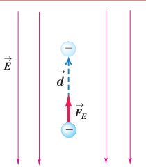

گرچه این رابطه را برای میدان الکتریکی یکنواخت بیان کردیم، اما برای میدان‌های الکتریکی غیریکنواخت نیز برقرار است. توجه کنید که در این رابطه علامت $q$ باید در نظر گرفته شود. جدول ۱ـ۳ برخی از اختلاف پتانسیل‌ها (ولتاژهای) متداول را نشان می‌دهد.

در تشابه با انرژی پتانسیل گرانشی، در اینجا نیز می‌توانیم برای انرژی پتانسیل الکتریکی، مرجعی اختیار کنیم که در آن انرژی پتانسیل الکتریکی ذره و پتانسیل الکتریکی صفر باشد. بنابراین، پتانسیل الکتریکی در هر نقطه از میدان با رابطۀ زیر بیان می‌شود:

$$V=\frac{U_E}{q}\tag{1-10}$$

### جدول ۱ـ۳ برخی از ولتاژهای متداول

| مورد | ولتاژ |
|---|---:|
| پتانسیل استراحت نورون | ۶۰–۹۰ mV |
| باتری قلمی | ۱/۵ V |
| باتری اتومبیل | ۱۲ V |
| برق خانگی در برخی از کشورها | ۱۱۰–۱۲۰ V |
| برق خانگی در ایران و اغلب کشورها | ۲۲۰–۲۴۰ V |
| مولد نیروگاه برق | ۲۴۰۰۰ V |
| خطوط انتقال برق ولتاژ بالا | $10^4$–$10^6$ V |
| آذرخش | $10^8$–$10^9$ V |

### مثال ۱ـ۱۱

در نتیجۀ برخورد پرتوهای کیهانی با مولکول‌های هوا، الکترون‌هایی از این مولکول‌ها کنده می‌شوند. در نزدیکی سطح زمین، میدان الکتریکی با بزرگی $150\,\mathrm{N/C}$ و جهت رو به پایین وجود دارد. الف) اگر یکی از این الکترون‌ها، تحت تأثیر این میدان $50\,\mathrm m$ رو به بالا جابه‌جا شود، انرژی پتانسیل الکتریکی آن چقدر تغییر می‌کند؟ ب) اختلاف پتانسیل الکتریکی دو نقطه‌ای که الکترون بین آنها جابه‌جا شده چقدر است؟

**پاسخ:** الف) با استفاده از رابطۀ ۱ـ۸ برای تغییر انرژی پتانسیل الکتریکی الکترون داریم

$$\Delta U_E=-W_E=-|q|Ed\cos\theta=-(1/60\times10^{-19}\,\mathrm C)(150\,\mathrm{N/C})(50\,\mathrm m)\cos0^\circ=-1/20\times10^{-15}\,\mathrm J$$

ب) با استفاده از رابطۀ ۱ـ۹ برای اختلاف پتانسیل داریم

$$\Delta V=\frac{\Delta U_E}{q}=\frac{-1/20\times10^{-15}\,\mathrm J}{-1/60\times10^{-19}\,\mathrm C}=7/50\times10^3\,\mathrm V=7/50\,\mathrm{kV}$$

### الساندرو ولتا (۱۷۴۵–۱۸۲۷م)

الساندرو ولتا در ایتالیا به دنیا آمد. نخست به شغل معلمی روی آورد و تا سن سی‌سالگی به این کار ادامه داد. سپس در دانشگاه پاویا به استادی فیزیک برگزیده شد. در آنجا وظیفه داشت علاوه بر تدریس، آزمایشگاهی نیز دایر کند. وقتی در دانشگاه تدریس می‌کرد دستگاهی به نام الکتروفور را اختراع کرد و شرح جزئیات دستگاه را برای جوزف پریستلی فرستاد. ولتا با استفاده از این دستگاه، قوانین فیزیکی زیادی را کشف کرد. در سال ۱۷۹۱ لوئیجی گالوانی استاد زیست‌شناسی و فیزیولوژی دانشگاه بولونیا موقعی که سرگرم تشریح قورباغه‌ای در آزمایشگاهش بود، یک گیره برنجی را در نخاع جانور قرار داد و متوجه شد که پس از برخورد ماهیچۀ پای قورباغه با چاقوی جراحی، خصوصاً وقتی قسمت بالای چاقو با گیره تماس پیدا کند، ماهیچه به شدت منقبض می‌شود و علت انقباض ماهیچۀ پای قورباغه را الکتریسیته‌ای پنداشت که در بدن جانور به‌وجود می‌آید. اما ولتا برخلاف گالوانی عقیده داشت منشأ پیدایش این الکتریسیته از بدن جانور نیست و در نامه‌ای به تاریخ ۱۸۰۰ میلادی دربارۀ پیلی توضیح داد که امروزه پیل ولتا خوانده می‌شود. پیل ولتا از تعدادی صفحات نقره، مقوای آغشته به یک محلول الکترولیت و روی درست شده است که به ترتیب روی هم چیده شده‌اند. این پیل یک منبع الکتریسیته بود که امروزه به نام باتری خشک مورد استفاده قرار می‌گیرد. اختراع ولتا راه تازه‌ای را در پیشرفت علم گشود و با استفاده از پیل ولتا، دانشمندان توانستند در مدت زمان کوتاهی آب را به دو عنصر اکسیژن و هیدروژن تجزیه کنند.
