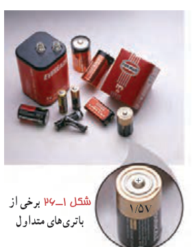
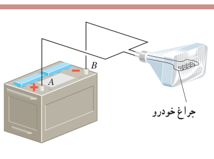

### تمرین ۱ـ۹

الف) نشان دهید در یک میدان الکتریکی یکنواخت، با حرکت در سوی خطوط میدان، بدون توجه به نوع بار، پتانسیل الکتریکی کاهش می‌یابد و بالعکس با حرکت در خلاف جهت خطوط میدان، بدون توجه به نوع بار، پتانسیل الکتریکی افزایش می‌یابد.

ب) نشان دهید در میدان الکتریکی یکنواخت، با حرکت در جهت عمود بر خطوط میدان، پتانسیل الکتریکی تغییر نمی‌کند.

شما با انواع باتری‌ها که در وسیله‌های الکتریکی نظیر چراغ‌قوه یا گوشی تلفن همراه از آنها استفاده می‌شود (شکل ۱ـ۲۶) و نیز با باتری خودرو آشنایی دارید. باتری‌ها ولتاژهای متفاوتی دارند؛ مثلاً باتری خودروهای سواری معمولاً ۱۲ ولتی و باتری کامیون‌ها ۲۴ ولتی یا بیشترند. هر باتری دو پایانه دارد که یکی با مثبت و دیگری با منفی نشان داده می‌شود. بنا به قرارداد، اختلاف پتانسیل الکتریکی دو سر باتری برابر با پتانسیل پایانۀ مثبت منهای پتانسیل پایانۀ منفی است. اگر پتانسیل پایانۀ منفی را با $V_-$ و پتانسیل پایانۀ مثبت را با $V_+$ نشان دهیم، داریم:

$$\Delta V=V_+-V_-$$

بنابراین، وقتی می‌گوییم باتری خودرو ۱۲ ولت است، یعنی پتانسیل پایانۀ مثبت به اندازۀ ۱۲ ولت از پتانسیل پایانۀ منفی آن بیشتر است؛ مثلاً اگر پتانسیل پایانۀ منفی را برابر با $-4\,\mathrm V$ فرض کنیم، پتانسیل پایانۀ مثبت برابر $+8\,\mathrm V$ خواهد شد. می‌توان پایانۀ منفی را مرجع پتانسیل در نظر گرفت؛ در این صورت، پتانسیل پایانۀ مثبت برابر $+12\,\mathrm V$ می‌شود. معمولاً (به‌خصوص در مهندسی برق) پتانسیل زمین یا نقطه‌ای از مدار را برابر صفر می‌گیرند و به آن نقطه، اصطلاحاً نقطۀ زمین می‌گویند و پتانسیل نقطه‌های دیگر را نسبت به آن می‌سنجند. نقطۀ زمین را در مدارهای الکتریکی با نماد زمین نشان می‌دهند.

شکل ۱ـ۲۶ برخی از باتری‌های متداول.

### تمرین ۱ـ۱۰

اگر پایانۀ مثبت یک باتری ۱۲ ولتی را مرجع پتانسیل در نظر بگیریم، پتانسیل پایانۀ منفی آن چند ولت خواهد شد؟

### مثال ۱ـ۱۲

اختلاف پتانسیل الکتریکی پایانه‌های باتری خودروی نشان داده شده در شکل برابر $12/0\,\mathrm V$ است. اگر بار الکتریکی $-50/0$ کولن از پایانۀ منفی به پایانۀ مثبت باتری جابه‌جا شود، انرژی پتانسیل الکتریکی آن چقدر تغییر می‌کند؟

**پاسخ:** با استفاده از رابطۀ ۱ـ۹ داریم:

$$\Delta V=\frac{\Delta U_E}{q}$$
$$\Delta U=q\Delta V=q(V_+-V_-)=(-50/0\,\mathrm C)(+12/0\,\mathrm V)=-600\,\mathrm J$$

بنابراین، انرژی پتانسیل الکتریکی این بار به اندازۀ ۶۰۰ J کاهش یافته است.
