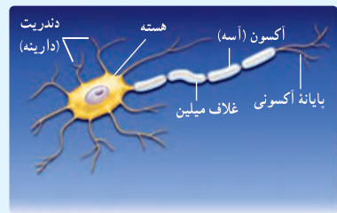
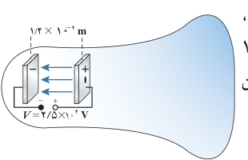

### فعالیت ۱ـ۶

عمل مغز اساساً بر مبنای کنش‌ها و فعالیت‌های الکتریکی است. سیگنال‌های عصبی چیزی جز عبور جریان‌های الکتریکی نیست. مغز این سیگنال‌ها را دریافت می‌کند و اطلاعات به‌صورت سیگنال‌های الکتریکی در امتداد اعصاب گوناگون منتقل می‌شوند. هنگام انجام هر عمل خاصی، سیگنال‌های الکتریکی زیادی تولید می‌شوند. این سیگنال‌ها حاصل کنش الکتروشیمیایی در یاخته‌های عصبی موسوم به نورون هستند. دربارۀ چگونگی کار نورون‌ها تحقیق و به کلاس گزارش کنید.

**رابطۀ اختلاف پتانسیل دو نقطه و اندازۀ میدان الکتریکی یکنواخت:** همان‌طور که پیش‌تر گفتیم اختلاف پتانسیل الکتریکی دو نقطه از میدان الکتریکی، مستقل از نوع و اندازۀ بار جابه‌جا شده بین دو نقطه است. بنابراین، می‌توانیم فرض کنیم بار جابه‌جا شده بین دو نقطه مثبت است. همچنین فرض کنید این بار مثبت را در میدان الکتریکی یکنواخت $\vec E$ هم‌جهت با خطوط میدان به اندازۀ $d$ جابه‌جا کنیم. بنا به رابطۀ ۱ـ۸ و با توجه به مثبت بودن $q$ و صفر بودن زاویۀ $\theta$ داریم

$$\Delta U_E=-|q|Ed\cos0^\circ=-qEd$$

از طرفی با استفاده از رابطۀ ۱ـ۹ داریم

$$\Delta U_E=q\Delta V$$

با برابر قرار دادن دو رابطۀ بالا به رابطۀ زیر می‌رسیم

$$\Delta V=-Ed$$

توجه کنید که این رابطه را برای حرکت در جهت میدان الکتریکی به دست آوردیم. اگر در خلاف جهت میدان حرکت می‌کردیم به رابطۀ $\Delta V=Ed$ می‌رسیدیم. پس در هر دو حالت می‌توان گفت:

$$|\Delta V|=Ed\tag{1-11}$$

در این رابطه $\Delta V$ برحسب ولت، $E$ برحسب نیوتون بر کولن، و $d$ برحسب متر است. بنابراین می‌توان نوشت: $1\,\mathrm{N/C}=1\,\mathrm{V/m}$.

### مثال ۱ـ۱۳

لامپ‌های تصویر تلویزیون‌ها و نمایشگرهای قدیمی، لامپ پرتو ـ کاتدی¹ (CRT) بودند. در این لامپ، الکترون‌ها در میدان الکتریکی یکنواخت بین دو صفحۀ باردار، مطابق شکل، شتاب می‌گیرند و با صفحۀ نمایشگر برخورد می‌کنند. اگر صفحه‌ها در فاصلۀ $1/2\times10^{-2}\,\mathrm m$ از یکدیگر باشند و اختلاف پتانسیل بین آنها $2/5\times10^4\,\mathrm V$ باشد، بزرگی میدان الکتریکی بین صفحه‌ها را تعیین کنید.

**پاسخ:** با استفاده از رابطۀ ۱ـ۱۱ داریم:

$$E=\frac{|\Delta V|}{d}=\frac{2/5\times10^4\,\mathrm V}{1/2\times10^{-2}\,\mathrm m}=2/08\times10^6\,\mathrm{V/m}\approx2/1\,\mathrm{MV/m}$$

۱ـ Cathode – Ray Tube
