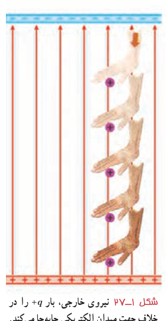

**کار انجام شده توسط نیروی خارجی:** فرض کنید در یک میدان الکتریکی یکنواخت، ذره‌ای با بار $q$، با اعمال نیرویی از نقطه‌ای به نقطۀ دیگر جابه‌جا شود (شکل ۱ـ۲۷). در حین این حرکت، نیروی خارجی، کار $W_{\text{خارجی}}$ را روی بار انجام می‌دهد، درحالی که نیروی الکتریکی نیز کار $W_E$ را روی آن انجام داده است. با استفاده از قضیۀ کار ـ انرژی جنبشی، تغییر انرژی جنبشی بار $q$ چنین می‌شود:

$$\Delta K=W_{\text{خارجی}}+W_E=W_{\text{خارجی}}-q\Delta V\tag{1-12}$$

که در آن از رابطه‌های ۱ـ۷ ($W_E=-\Delta U_E$) و ۱ـ۹ ($\Delta U_E=q\Delta V$) استفاده کرده‌ایم.

حال فرض کنید که تندی بار $q$ در ابتدا و انتهای این جابه‌جایی یکسان باشد (یعنی $\Delta K=0$). آنگاه معادلۀ بالا به‌صورت زیر درمی‌آید:

$$W_{\text{خارجی}}=-W_E=q\Delta V\qquad(\text{برای }\Delta K=0)\tag{1-13}$$

در این حالت خاص، بسته به علامت و بزرگی $q$ و $\Delta V$، کار $W_{\text{خارجی}}$ می‌تواند مثبت، منفی یا صفر باشد.

شکل ۱ـ۲۷ نیروی خارجی، بار $+q$ را در خلاف جهت میدان الکتریکی جابه‌جا می‌کند.

### تمرین ۱ـ۱۱

در شکل ۱ـ۲۷ الف) با فرض آنکه بار $+q$ در ابتدا و انتهای جابه‌جایی ساکن باشد، آیا کار نیروی خارجی، مثبت است یا منفی؟ ب) آیا بار $+q$ به نقطه‌ای با پتانسیل بیشتر حرکت کرده است یا به نقطه‌ای با پتانسیل کمتر؟ توضیح دهید.

## ۱ـ۹ میدان الکتریکی در داخل رساناها

جسم رسانایی را در نظر بگیرید. به نظر شما اگر باری اضافی به این جسم داده شود، چگونه در آن توزیع می‌شود؟ اگر این جسم در میدان الکتریکی خارجی قرار گیرد، توزیع میدان در داخل و خارج آن چگونه می‌شود؟ در ادامه به توضیح آزمایشی می‌پردازیم که به قسمتی از این پرسش‌ها پاسخ می‌دهد.

**توزیع بار الکتریکی در رسانا ـ آزمایش فاراده:** نخستین بار بنجامین فرانکلین برای پی‌بردن به اینکه بار الکتریکی داده شده به رسانای خنثی چگونه در آن توزیع می‌شود، آزمایشی را در سال ۱۷۵۵ میلادی انجام داد. تقریباً ۸۰ سال بعد (۱۸۳۶ میلادی) این آزمایش توسط مایکل فارادۀ انگلیسی به‌گونه‌ای دیگر تکرار شد. در ادامه به توضیح نوعی از آزمایش فاراده می‌پردازیم که اندکی با آزمایش اصلی او متفاوت است.

ظرف رسانایی با درپوش فلزی را در نظر بگیرید که روی پایۀ نارسانایی قرار دارد و روی درپوش آن دسته‌ای عایق نصب شده است. ابتدا ظرف بدون بار است. یک گوی فلزی را که از نخ عایقی آویزان است باردار و سپس وارد ظرف می‌کنیم (شکل ۱ـ۲۸ـ الف). اکنون گوی را با کف ظرف تماس می‌دهیم و سپس درپوش فلزی را می‌بندیم (شکل ۱ـ۲۸ـ ب). آن‌گاه درپوش فلزی را با دستۀ عایقش برمی‌داریم (شکل ۱ـ۲۸ـ پ).
