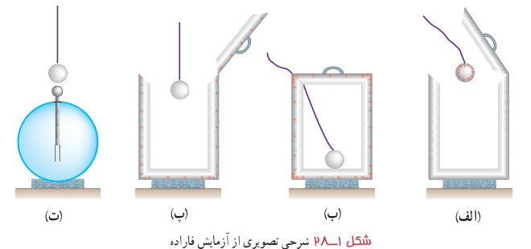
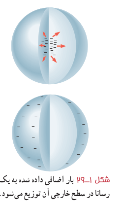
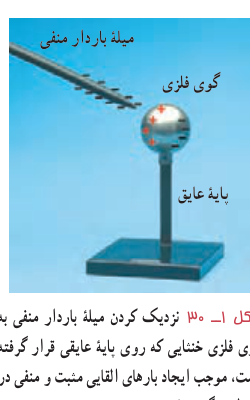
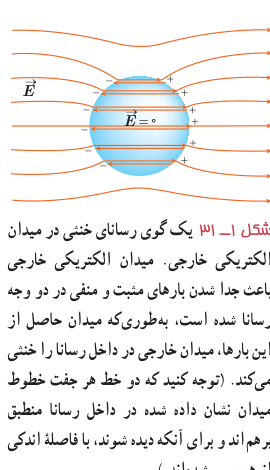

شکل ۱ـ۲۸ شرحی تصویری از آزمایش فاراده.

پس از خارج کردن گوی فلزی از ظرف، آن را به کلاهک الکتروسکوپ نزدیک می‌کنیم. مشاهده می‌شود عقربۀ الکتروسکوپ تکان نمی‌خورد (شکل ۱ـ۲۸ـ ت). همچنین اگر ظرف را به الکتروسکوپ نزدیک کنیم، مشاهده می‌شود که عقربه‌های الکتروسکوپ از هم فاصله می‌گیرند.

از این آزمایش نتیجه می‌گیریم که بار اضافی داده شده به یک رسانا روی سطح خارجی آن توزیع می‌شود. شکل ۱ـ۲۹ طرحی از توزیع بار داده شده در سطح خارجی یک رسانا را نشان می‌دهد.

بررسی‌های دقیق نشان می‌دهند پس از مدت زمان بسیار کوتاهی از دادن بار به رسانا (برای فلزات این زمان از مرتبۀ $10^{-16}\,\mathrm s$ است)، بار در سطح خارجی رسانا توزیع می‌شود و نحوۀ توزیع بار در رسانا به‌گونه‌ای است که میدان الکتریکی در داخل رسانا صفر شود. به عبارت دیگر در شرایط الکتروستاتیکی، میدان الکتریکی در داخل رسانا نمی‌تواند صفر نباشد؛ زیرا اگر این میدان صفر نباشد، بر الکترون‌های آزاد داخل رسانا نیروی الکتریکی (طبق رابطۀ $\vec F=q\vec E$) وارد می‌کند و سبب ایجاد جریان الکتریکی در داخل رسانا می‌شود که این بدین معناست که بارها در تعادل الکتروستاتیکی قرار ندارند.

شکل ۱ـ۲۹ بار اضافی داده شده به یک رسانا در سطح خارجی آن توزیع می‌شود.

**رسانای خنثی در میدان الکتریکی:** در علوم هشتم با پدیدۀ القا آشنا شدید. در شکل ۱ـ۳۰ جسم رسانای خنثایی که بر روی آن بار القا می‌شود در میدان الکتریکی خارجی میله قرار گرفته است. وقتی یک رسانای خنثی را در یک میدان الکتریکی خارجی قرار می‌دهیم، باز هم در مدت زمان بسیار کوتاهی الکترون‌های آزاد تحت تأثیر میدان الکتریکی خارجی، طوری روی سطح خارجی توزیع می‌شوند (**القا می‌شوند**) که میدان الکتریکی ناشی از آنها اثر میدان خارجی را درون رسانا خنثی کند و بدین ترتیب میدان الکتریکی خالص درون رسانا صفر شود. شکل ۱ـ۳۱ یک گوی رسانا را نشان می‌دهد که در میدان الکتریکی خارجی قرار گرفته است. نحوۀ توزیع بار روی گوی به گونه‌ای است که میدان الکتریکی در داخل رسانا صفر شده است.

شکل ۱ـ۳۰ نزدیک کردن میلۀ باردار منفی به گوی فلزی خنثایی که روی پایۀ عایقی قرار گرفته است، موجب ایجاد بارهای القایی مثبت و منفی در دو طرف گوی فلزی می‌شود.

شکل ۱ـ۳۱ یک گوی رسانای خنثی در میدان الکتریکی خارجی. میدان الکتریکی خارجی باعث جدا شدن بارهای مثبت و منفی در دو وجه رسانا شده است، به‌طوری‌که میدان حاصل از این بارها، میدان خارجی در داخل رسانا را خنثی می‌کند. (توجه کنید که دو خط در جهت خطوط میدان نشان داده شده در داخل رسانا منطبق برهم‌اند و برای آنکه دیده شوند، با فاصلۀ اندکی از هم رسم شده‌اند.)

چون میدان الکتریکی درون رسانایی که در تعادل الکتروستاتیکی است برابر با صفر است، نیروی الکتریکی وارد بر هر ذرۀ باردار در داخل رسانا نیز صفر می‌شود. بنابراین، کار نیروی الکتریکی در هر جابه‌جایی دلخواهی در داخل رسانا صفر می‌شود. در نتیجه همۀ نقاط رسانا پتانسیل یکسانی دارند. به عبارت دیگر:

$$F_E=0\Rightarrow\Delta U_E=-W_E=0$$
$$\Delta V=\frac{\Delta U_E}{q}=0\Rightarrow V_2-V_1=0\Rightarrow V_1=V_2$$
