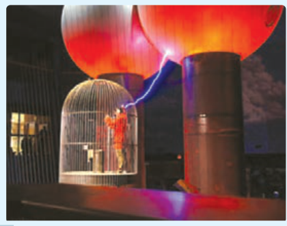
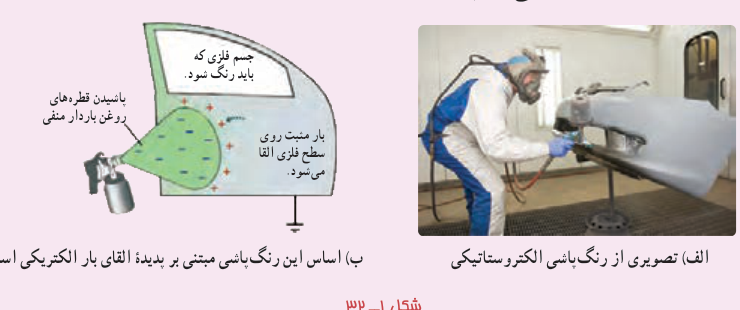

### فعالیت ۱ـ۷

الف) در شکل شخصی را داخل یک قفس توری فلزی می‌بینید که نوعی از قفس فاراده است. در مورد قفس فاراده و کاربردهایش تحقیق و به کلاس گزارش کنید.

ب) چرا معمولاً شخصی که در داخل اتومبیل یا هواپیماست از خطر آذرخش در امان می‌ماند.

پ) با اعضای گروه خود آزمایش‌های دیگری را طراحی و اجرا کنید که نشان دهد بار اضافی داده شده به رسانا، روی سطح داخلی رسانا توزیع نمی‌شود.

### فناوری و کاربرد

یکی از کاربردهای صنعتی پدیدۀ القای بار الکتریکی، رنگ‌پاشی الکتروستاتیکی است (شکل ۱ـ۳۲ـ الف). در نوعی از این روش رنگ‌پاشی، سطح فلزی‌ای که قرار است رنگ شود به زمین متصل می‌شود. از طرفی قطره‌های ریز رنگ هنگام خروج از دهانۀ رنگ‌پاش باردار می‌شوند. با نزدیک شدن قطره‌های رنگ به هدف فلزی، بارهای القایی با علامت مخالف بر روی فلز ظاهر می‌شوند و به این ترتیب، قطره‌ها را به سطح فلز جذب می‌کنند (شکل ۱ـ۳۲ـ ب). این روش رنگ‌پاشی، پاشیده شدن رنگ از افشانۀ قطره‌ها را کاهش می‌دهد و رنگ یکنواختی بر سطح جسم فلزی ایجاد می‌کند.

شکل ۱ـ۳۲ الف) تصویری از رنگ‌پاشی الکتروستاتیکی. ب) اساس این رنگ‌پاشی مبتنی بر پدیدۀ القای بار الکتریکی است.

**چگالی سطحی بار الکتریکی رسانا:** برای اینکه بتوانیم تراکم بار الکتریکی در بخش‌های مختلف سطح یک جسم را با هم مقایسه کنیم کمیتی به نام **چگالی سطحی بار** را تعریف می‌کنیم. اگر مساحت سطحی که بار روی آن توزیع شده است برابر $A$ و بار الکتریکی موجود در آن سطح برابر $Q$ باشد چگالی سطحی بار که با نماد $\sigma$ نشان داده می‌شود از رابطۀ زیر به‌دست می‌آید:

$$\sigma=\frac QA\tag{1-14}$$

در این رابطه چگالی سطحی بار ($\sigma$) برحسب کولن بر مترمربع ($\mathrm{C/m^2}$) می‌شود. اکنون می‌خواهیم چگالی سطحی بار الکتریکی در رسانا را بررسی کنیم. دیدیم که بار الکتریکی روی
