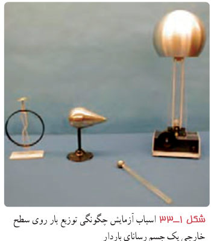
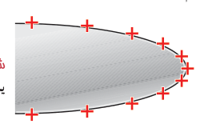
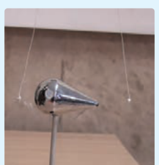

سطح خارجی رسانا توزیع می‌شود. برای اینکه دریابیم بار الکتریکی داده‌شده به یک رسانا چگونه روی سطح خارجی آن توزیع می‌شود از تعریف چگالی سطحی بار استفاده می‌کنیم. به این منظور آزمایش زیر را در نظر بگیرید که اسباب آن در شکل ۱ـ۳۳ نشان داده شده است. یک جسم رسانای دوکی‌شکل را روی پایۀ عایق قرار دهید و آن را با تماس با کلاهک مولد وان‌دوگراف باردار کنید. گلوله‌ای فلزی را که به دسته‌ای عایق متصل است با بخش پهن دوک تماس داده و سپس گلوله را به سر الکتروسکوپ تماس دهید. همین آزمایش را پس از خنثی کردن الکتروسکوپ و گوی فلزی با تماس با دستتان، با نوک تیز دوک انجام دهید. خواهید دید، انحراف صفحه‌های الکتروسکوپ با نوک تیز دوک بیشتر از انحراف صفحه‌ها با بخش پهن آن است. آزمایش‌هایی از این دست نشان می‌دهد تراکم بار و چگالی سطحی بار در نقاط تیز سطح جسم رسانای باردار از نقاط دیگر آن بیشتر است (شکل ۱ـ۳۴). همچنین می‌توان نشان داد که خطوط میدان الکتریکی در نقاط نوک‌تیز چنین رسانایی متراکم‌تر و میدان الکتریکی در نزدیکی این نقاط، قوی‌تر است.

شکل ۱ـ۳۳ اسباب آزمایش چگونگی توزیع بار روی سطح خارجی یک جسم رسانای باردار.

شکل ۱ـ۳۴ چگالی بار در نقاط تیزتر سطح یک جسم رسانای باردار بیشتر است.

### فعالیت ۱ـ۸

دو قطعه ورقۀ آلومینیمی نازک به ابعاد $3\,\mathrm{cm}\times4\,\mathrm{cm}$ را مچاله کنید و به سرهای دو تکه نخ هم‌اندازه به طول $30\,\mathrm{cm}$ وصل کنید. پس از آنکه جسم فلزی دوکی‌شکل را با مولد وان‌دوگراف باردار کردید، یکی از آونگ‌ها را مقابل نوک تیز و دیگری را مقابل بخش پهن دوک بیاویزید. چه مشاهده می‌کنید؟ مشاهدۀ خود را توجیه کنید.

### مثال ۱ـ۱۴

سطح فلزی بزرگ بارداری را در نظر بگیرید که بار الکتریکی در سطح آن و دور از لبه‌ها به‌طور یکنواخت توزیع شده است. اگر چگالی بار روی این سطح $2/0\times10^{-6}\,\mathrm{C/m^2}$ باشد، در بخشی از این سطح به شکل مربعی به ضلع $1/0\,\mathrm{mm}$ چقدر بار قرار گرفته است؟

**پاسخ:** با استفاده از رابطۀ ۱ـ۱۴ و تبدیل یکاها در SI، خواهیم داشت:

$$Q=\sigma A=(2/0\times10^{-6}\,\mathrm{C/m^2})(1/0\times10^{-3}\,\mathrm m\times1/0\times10^{-3}\,\mathrm m)=2/0\times10^{-12}\,\mathrm C=2/0\,\mathrm{pC}$$
