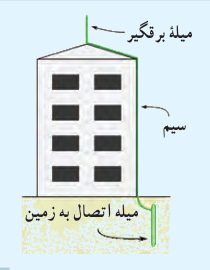
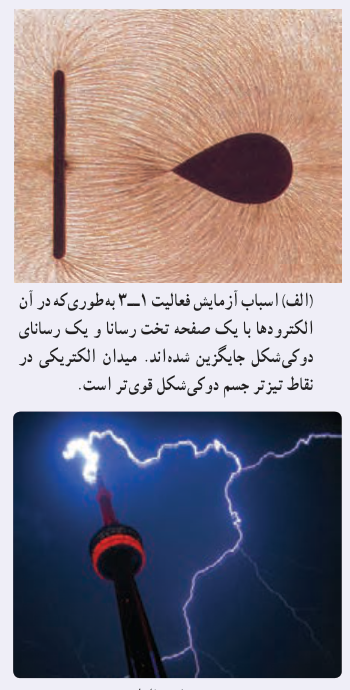

### فعالیت ۱ـ۹

در مورد برق‌گیرهای ساختمان تحقیق کنید و بررسی کنید آنها چگونه ساختمان‌ها را از گزند آذرخش در امان نگه می‌دارند.

### خوب است بدانید: تخلیۀ هاله‌ای¹

همان‌طور که دیدیم در قسمت‌های نوک‌تیز اجسام رسانا، چگالی سطحی بار الکتریکی بیشتر است. با اسباب آزمایش فعالیت ۱ـ۳ می‌توان نشان داد که خطوط میدان الکتریکی در نقاط نوک‌تیز متراکم‌تر و در نتیجه میدان الکتریکی قوی‌تر است (شکل الف). اگر بزرگی این میدان از یک مقدار حدی فراتر برود، این میدان شدید می‌تواند الکترون‌ها را از مولکول‌های هوا بکند و به آنها شتاب دهد. برخورد این الکترون‌ها با مولکول‌های دیگر موجب برانگیختگی این مولکول‌ها می‌شود و در نتیجه نوری تولید می‌شود که قابل مشاهده است (شکل ب). هنگام وقوع این پدیده، جنبش مولکولی، دما، و فشار هوا در محل وقوع این پدیده زیاد می‌شود که این معمولاً همراه با صدای جلز و ولز و هیس مانندی است که در حین تخلیه‌های جرقه‌ای شنیده می‌شود. به این جرقه‌های الکتریکی که در نوک تیز اجسام رسانای بلند و نازک ایجاد می‌شود، تخلیۀ هاله‌ای یا آتش سنت المو² گفته می‌شود.

الف) اسباب آزمایش فعالیت ۱ـ۳ به‌طوری‌که در آن الکترودها با یک صفحۀ تخت رسانا و یک رسانای دوکی‌شکل جایگزین شده‌اند. میدان الکتریکی در نقاط تیزتر جسم دوکی‌شکل قوی‌تر است. ب) تخلیۀ هاله‌ای.

### خوب است بدانید: مولد وان‌دوگراف

مولد وان‌دوگراف، دستگاهی است که بار الکتریکی روی کلاهک فلزی آن انباشته می‌شود. اگر یک جسم رسانا با کلاهک این دستگاه تماس پیدا کند و یا در نزدیکی آن قرار گیرد می‌تواند دارای بار الکتریکی شود.

در نمونۀ سادۀ مولد وان‌دوگراف، غلتک پایینی توسط یک موتور الکتریکی می‌چرخد و تسمه روی دو غلتک چرخانده می‌شود.

۱ـ Corona discharge  
۲ـ St. Elmo fire
