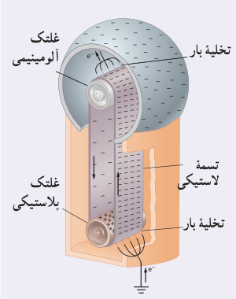
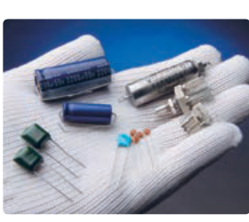
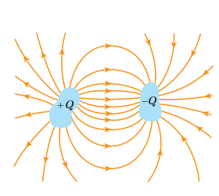

معمولاً غلتک پایینی از جنس پلاستیک پلی‌اتیلن و غلتک بالایی از جنس آلومینیم است. بر اثر مالش تسمه‌ای لاستیکی با غلتک پایینی، این غلتک بنا بر سری الکتریسیتۀ مالشی، بار مثبت پیدا می‌کند. غلتک پایینی که بار مثبت دارد، در یک شانۀ فلزی که متصل به زمین است، بار منفی القا می‌کند. بار منفی توسط این شانه روی سطح بیرونی تسمه قرار داده می‌شود. در غلتک بالایی، تسمۀ لاستیکی باردار منفی، الکترون‌ها را از نوک‌های شانۀ فلزی دفع می‌کند و نیز بار منفی از تسمه به شانه و سپس از شانه به سطح خارجی کلاهک منتقل می‌شود. به این ترتیب، بار الکتریکی منفی روی سطح خارجی کلاهک انباشته می‌شود. با انتخاب جنس‌های دیگری برای غلتک که در سری الکتریسیتۀ مالشی پایین‌تر از لاستیک قرار دارند (مانند تفلون) می‌توان بار الکتریکی مثبت روی کلاهک ایجاد کرد.

## ۱ـ۱۰ خازن

خازن وسیله‌ای الکتریکی است که می‌تواند بار و انرژی الکتریکی را در خود ذخیره کند؛ مثلاً باتری‌های یک دوربین با باردار کردن یک خازن، انرژی را در خازن فلاش دوربین ذخیره می‌کنند (شکل ۱ـ۳۵). باتری‌ها معمولاً می‌توانند انرژی را فقط با آهنگ نسبتاً کمی به مدار بدهند که این آهنگ برای گسیل نور از فلاش دوربین بسیار کم است، اما وقتی خازن باردار می‌شود، می‌تواند انرژی را با آهنگ بسیار زیادی برای فلاش زدن آماده کند.

شکل ۱ـ۳۵ انرژی فلاش دوربین در یک خازن ذخیره شده است.

شکل ۱ـ۳۶ چند خازن را در اندازه‌ها و شکل‌های مختلف نشان می‌دهد. شکل ۱ـ۳۷ اجزای اصلی یک خازن معمولی را نشان می‌دهد که شامل دو رسانا با هر شکلی است. این رساناها را صفحه‌های خازن می‌نامیم.

شکل ۱ـ۳۶ تصویری از چند خازن مختلف.

شکل ۱ـ۳۷ اجزای اصلی یک خازن باردار.

شکل ۱ـ۳۸ آرایش خازنی موسوم به خازن تخت¹ را نشان می‌دهد که شامل دو صفحۀ رسانای موازی با مساحت $A$ است که به فاصلۀ $d$ (که در برابر ابعاد صفحه‌ها ناچیز است) از هم قرار گرفته‌اند. گرچه نمادی که برای نشان دادن یک خازن به‌کار می‌بریم مبتنی بر شکل یک خازن تخت است، ولی از آن برای نشان دادن خازن‌ها با هر شکلی استفاده می‌شود. خازن‌ها به‌طور گسترده‌ای در مدارهای الکترونیکی وسایلی مانند رادیو، تلویزیون، رایانه، گوشی همراه و ... به‌کار می‌روند؛ مثلاً شکل ۱ـ۳۹ مدار یک تقویت‌کننده (آمپلی‌فایر) را نشان می‌دهد که در آن چندین خازن به‌کار رفته است. برخی از این خازن‌ها با پیکان‌هایی مشخص شده‌اند.

**باردار (شارژ) کردن خازن:** روش ساده و مرسوم برای باردار کردن خازن قرار دادن آن در مدار الکتریکی ساده‌ای است که یک باتری دارد (شکل ۱ـ۴۰ـ الف). وقتی کلید K بسته (وصل) شود بار از طریق سیم‌های رسانا جریان می‌یابد. این شارش بار تا هنگامی ادامه پیدا می‌کند که اختلاف پتانسیل میان دو صفحۀ خازن با اختلاف پتانسیل میان دو پایانۀ باتری یکسان شود. وقتی یک خازن باردار می‌شود، صفحه‌های آن دارای بارهایی با بزرگی یکسان، ولی با علامت مخالف می‌شود: $+Q$ و $-Q$. با این حال،

۱ـ parallel – plate capacitor
