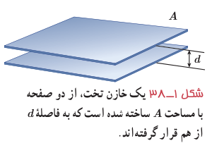
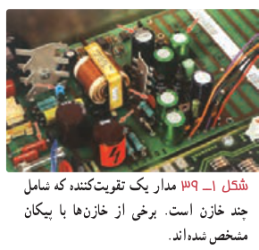
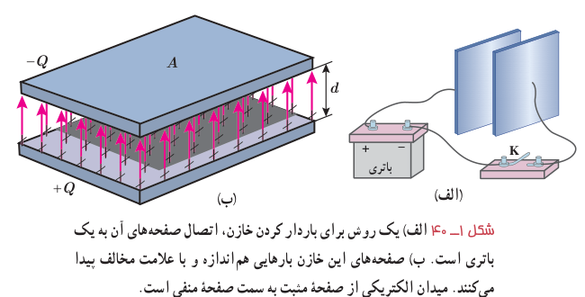
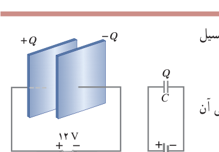

بار یک خازن را به‌صورت $Q$ نشان می‌دهند که همان بار صفحۀ مثبت است. بین دو صفحۀ خازن باردار یک میدان الکتریکی ایجاد می‌شود که خطوط این میدان از صفحۀ مثبت به منفی است (شکل ۱ـ۴۰ـ ب).

شکل ۱ـ۳۸ یک خازن تخت، از دو صفحه با مساحت $A$ ساخته شده است که به فاصلۀ $d$ از هم قرار گرفته‌اند.

شکل ۱ـ۳۹ مدار یک تقویت‌کننده که شامل چند خازن است. برخی از خازن‌ها با پیکان مشخص شده‌اند.

شکل ۱ـ۴۰ الف) یک روش برای باردار کردن خازن، اتصال صفحه‌های آن به یک باتری است. ب) صفحه‌های این خازن بارهایی هم‌اندازه و با علامت مخالف پیدا می‌کنند. میدان الکتریکی از صفحۀ مثبت به سمت صفحۀ منفی است.

**ظرفیت خازن:** اگر اختلاف پتانسیل بین صفحه‌های خازن ($\Delta V$) را زیاد کنیم، بار خازن ($Q$) نیز به همان نسبت زیاد می‌شود. به‌عبارتی نسبت $Q/\Delta V$ همواره مقداری ثابت است که به این نسبت ثابت، ظرفیت خازن می‌گویند و آن را با $C$ نشان می‌دهند. عبارت ظرفیت الکتریکی را نخستین بار ولتا در تشابه با ظرفیت گرمایی به‌کار برد. بنا به دلایل تاریخی، قدرمطلق اختلاف پتانسیل $\Delta V$ بین دو صفحۀ خازن را با $V$ نمایش می‌دهند. بنابراین:

$$C=\frac QV\tag{1-15}$$

در رابطۀ ۱ـ۱۵ یکای بار الکتریکی، کولن (C)، یکای اختلاف پتانسیل، ولت (V) و بنابراین یکای ظرفیت، کولن بر ولت (C/V) می‌شود که به پاس خدمات مایکل فاراده، فاراد (F) نامیده شده است. فاراد یکای بسیار بزرگی است و عملاً ظرفیت اکثر خازن‌های متداول در محدودۀ پیکوفاراد ($10^{-12}\,\mathrm F$) تا میلی‌فاراد ($10^{-3}\,\mathrm F$) است. گرچه امروزه فناوری ساخت خازن‌ها، دستیابی به ظرفیت‌های بسیار بیشتر را نیز ممکن ساخته است.

ظرفیت خازن به ویژگی‌های هندسی و جنس عایق بین صفحه‌های خازن بستگی دارد و با تغییر بار یا اختلاف پتانسیل خازن، تغییر نمی‌کند.

### مثال ۱ـ۱۵

صفحه‌های خازنی را مطابق شکل به پایانه‌های یک باتری با اختلاف پتانسیل ۱۲ V وصل می‌کنیم. اگر بار خازن $24\,\mu\mathrm C$ شود، الف) ظرفیت خازن را محاسبه کنید. ب) اگر این خازن را به اختلاف پتانسیل ۳۶ V وصل کنیم، بار الکتریکی آن چقدر می‌شود؟

