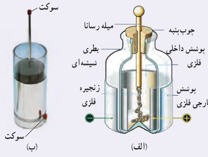
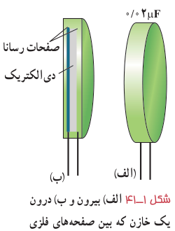

**پاسخ:** الف) با استفاده از رابطۀ ۱ـ۱۵ داریم:

$$C=\frac QV=\frac{24\times10^{-6}\,\mathrm C}{12\,\mathrm V}=2/0\times10^{-6}\,\mathrm F=2/0\,\mu\mathrm F$$

ب) با توجه به اینکه ظرفیت خازن همواره مقدار ثابتی است از ظرفیت به‌دست آمده در قسمت الف استفاده می‌کنیم. آنگاه با استفاده از رابطۀ ۱ـ۱۵ می‌توان نوشت:

$$Q=CV=(2/0\times10^{-6}\,\mathrm F)(36\,\mathrm V)=72\times10^{-6}\,\mathrm C=72\,\mu\mathrm C$$

### خوب است بدانید: بطری لیدن¹

بطری لیدن، قدیمی‌ترین نوع خازن است که در میانۀ سدۀ هجدهم در شهر لیدن که امروزه در هلند واقع شده است، ساخته شد. در یک نوع ابتدایی، این خازن از یک بطری شیشه‌ای ساخته شده است که سطح درونی و بیرونی آن با ورقۀ نازک قلع پوشیده شده است. ورقۀ درونی توسط سیم یا زنجیری فلزی به میلۀ فلزی ثابت داخل بطری اتصال دارد (شکل الف). امروزه برای باردار کردن بطری لیدن، روی بدنۀ فلزی و سر میلۀ فلزی سوکت (جای فیش)هایی نصب شده است (شکل ب) تا از طریق آنها، خازن توسط قطب‌های یک مولد ولتاژ بالا مانند مولد وان‌دوگراف یا مولد ویم‌هرست² باردار می‌شود. ظرفیت یک بطری لیدن با اندازۀ متوسط از مرتبۀ ۱ nF است. آزمایش با بطری لیدن خطرناک است و باید تحت نظارت مربی یا دبیر محترم انجام شود.

## ۱ـ۱۱ خازن با دی‌الکتریک

اگر فضای میان صفحه‌های یک خازن را با ماده‌ای عایق (مانند کاغذ یا پلاستیک) که به آن دی‌الکتریک گفته می‌شود پر کنیم (شکل ۱ـ۴۱)، برای ظرفیت خازن چه پیش می‌آید؟ مایکل فاراده نخستین بار در سال ۱۸۳۷ میلادی، با استفاده از وسایل ساده‌ای دریافت که ظرفیت خازن با ضریبی موسوم به ثابت دی‌الکتریک مادۀ عایق (که آن را با $\kappa$³ نشان می‌دهند) افزایش می‌یابد؛ یعنی اگر ظرفیت خازن بدون دی‌الکتریک را با $C_0$ نمایش دهیم آن‌گاه ظرفیت خازن با دی‌الکتریک برابر است با

$$C=\kappa C_0\tag{1-16}$$

جدول ۱ـ۴ ثابت دی‌الکتریک چند مادۀ عایق را نشان می‌دهد.

فرض کنید خازنی را نخست توسط یک باتری باردار و سپس از باتری جدا کرده‌ایم. اکنون فضای داخل این خازن را با یک دی‌الکتریک پر می‌کنیم. توجه کنید که دی‌الکتریک‌ها بر دو نوع‌اند: قطبی و غیرقطبی. وقتی یک دی‌الکتریک قطبی (مانند آب، $\mathrm{NH_3}$، $\mathrm{HCl}$) در میدان الکتریکی بین دو صفحۀ

شکل ۱ـ۴۱ الف) بیرون و ب) درون یک خازن که بین صفحه‌های فلزی آن لایۀ عایقی قرار گرفته است.

۱ـ Leyden jar  ۲ـ Wimshurst Machine  ۳ـ از حروف الفبای یونانی که کاپا خوانده می‌شود.
