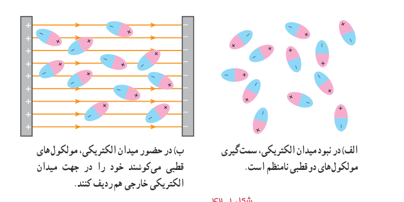
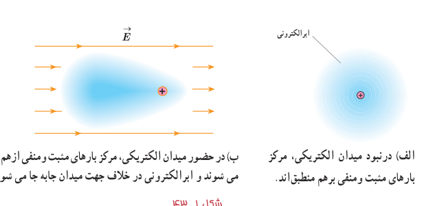

خازن قرار می‌گیرد، سر منفی مولکول‌های دوقطبی به‌طرف صفحۀ مثبت و سر مثبت آنها به طرف صفحۀ منفی کشیده می‌شود و در نتیجه این مولکول‌های دوقطبی می‌کوشند خود را در جهت میدان الکتریکی بین دو صفحۀ خازن هم‌ردیف کنند (شکل ۱ـ۴۲).

شکل ۱ـ۴۲ الف) در نبود میدان الکتریکی، سمت‌گیری مولکول‌های دوقطبی نامنظم است. ب) در حضور میدان الکتریکی، مولکول‌های قطبی می‌کوشند خود را در جهت میدان الکتریکی خارجی هم‌ردیف کنند.

### جدول ۱ـ۴ ثابت دی‌الکتریک برخی عایق‌ها در دمای ۲۰°C

| مادۀ دی‌الکتریک | ثابت دی‌الکتریک |
|---|---:|
| هوای ۱ atm | ۱/۰۰۰۶ |
| تفلون | ۲/۱ |
| پارافین | ۲/۲ |
| پلی‌استیرن | ۲/۶ |
| میلار | ۳/۱ |
| پی‌وی‌سی | ۳/۴ |
| کاغذ | ۳/۵ |
| کوارتز | ۴/۳ |
| شیشۀ پیرکس | ۵ |
| میکا | ۷ |
| آب خالص | ۸۰ |
| تیتانید استرانسیم | ۳۱۰ |

وقتی یک دی‌الکتریک غیرقطبی (مانند متان، بنزن و...) در میدان بین دو صفحۀ خازن قرار می‌گیرد بر اثر القا قطبیده می‌شود؛ یعنی میدان الکتریکی اعمال‌شده باعث می‌شود که ابر الکترونی مولکول‌های دی‌الکتریک در خلاف جهت میدان جابه‌جا شود (شکل ۱ـ۴۳) و به این ترتیب، مرکز بارهای مثبت و منفی مولکول‌ها از هم جدا شده و اصطلاحاً مولکول‌ها قطبیده شوند.

شکل ۱ـ۴۳ الف) در نبود میدان الکتریکی، مرکز بارهای مثبت و منفی برهم منطبق‌اند. ب) در حضور میدان الکتریکی، مرکز بارهای مثبت و منفی از هم جدا می‌شوند و ابر الکترونی در خلاف جهت میدان جابه‌جا می‌شود.

می‌توان نشان داد این رفتار مولکول‌های دی‌الکتریک (قطبی یا غیرقطبی) در میدان الکتریکی بین صفحه‌های خازن، سبب افزایش ظرفیت خازن می‌شود.

**ظرفیت خازن تخت:** آزمایش و محاسبه نشان می‌دهد که ظرفیت یک خازن تخت با مساحت صفحه‌های $A$ و فاصلۀ جدایی صفحه‌های $d$، از رابطۀ زیر به دست می‌آید:

$$C_0=\varepsilon_0\frac Ad\tag{1-17}$$
