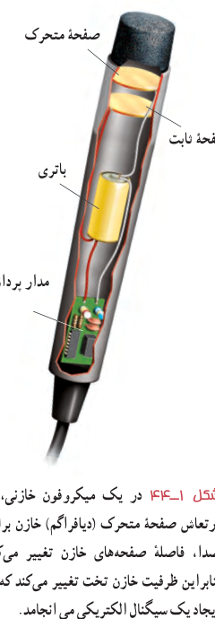
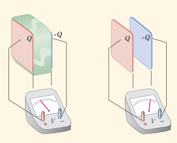
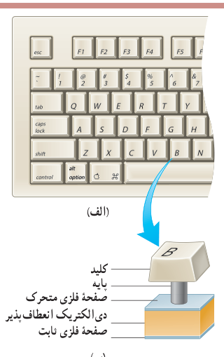

که در آن $\varepsilon_0$ همان ضریب گذردهی الکتریکی خلأ ($\varepsilon_0=8/85\times10^{-12}\,\mathrm{F/m}$) است. مثالی کاربردی از این رابطه، میکروفون خازنی است که بر اثر تغییر ظرفیت یک خازن تخت سیگنال الکتریکی ایجاد می‌کند (شکل ۱ـ۴۴).

حال اگر فضای بین صفحه‌های این خازن را با یک دی‌الکتریک با ثابت دی‌الکتریک $\kappa$ کاملاً پر کنیم، طبق رابطۀ ۱ـ۱۶ برای ظرفیت خازن جدید داریم:

$$C=\kappa\varepsilon_0\frac Ad\tag{1-18}$$

شکل ۱ـ۴۴ در یک میکروفون خازنی، با ارتعاش صفحۀ متحرک (دیافراگم) خازن بر اثر صدا، فاصلۀ صفحه‌های خازن تغییر می‌کند بنابراین ظرفیت خازن تخت تغییر می‌کند که به ایجاد یک سیگنال الکتریکی می‌انجامد.

### پرسش ۱ـ۶

در شکل زیر صفحه‌های باردار یک خازن تخت را که بین آنها هواست، به ولت‌سنج وصل می‌کنیم. با وارد کردن دی‌الکتریک در بین صفحه‌ها، اختلاف پتانسیل دو صفحه کاهش می‌یابد. علت آن را توضیح دهید. (توجه کنید که این آزمایش با بیشتر ولت‌سنج‌های معمولی و رایج ممکن نیست.)

### مثال ۱ـ۱۶

برخی از صفحه‌کلیدهای رایانه (شکل الف) بر مبنای تغییر ظرفیت خازن عمل می‌کنند. هر کلید این صفحه به یک سر پایه‌ای نصب شده است که سر دیگر آن به یک صفحۀ فلزی متحرک متصل است. این صفحۀ فلزی خود توسط یک دی‌الکتریک انعطاف‌پذیر از صفحۀ فلزی ثابتی جدا شده است و در واقع این دو صفحه یک خازن تخت را تشکیل می‌دهند (شکل ب). با فشار دادن کلید، صفحۀ متحرک به صفحۀ ثابت نزدیک می‌شود و ظرفیت خازن افزایش می‌یابد. این تغییر ظرفیت به‌صورت سیگنالی الکتریکی توسط مدارهای الکترونیکی رایانه آشکار می‌شود و بدین‌ترتیب، مشخص می‌شود که کدام کلید فشار داده شده است. فاصلۀ بین صفحه‌ها عموماً $5/00\times10^{-3}\,\mathrm m$ است که این فاصله با فشار دادن کلید به $0/150\times10^{-3}\,\mathrm m$ می‌رسد. مساحت صفحه‌ها $9/50\times10^{-5}\,\mathrm{m^2}$ است و خازن از ماده‌ای با ثابت دی‌الکتریک ۳/۵۰ پر شده است. تغییر ظرفیتی که با فشار دادن کلید، توسط مدارهای الکترونیکی رایانه آشکار می‌شود چقدر است؟

